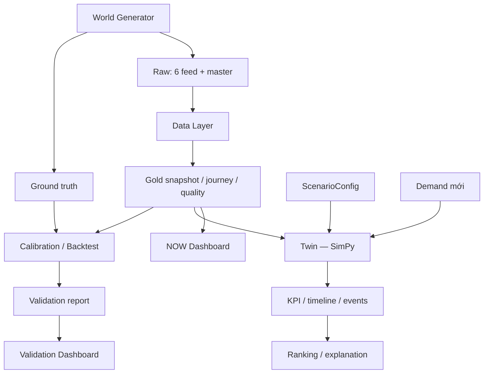

# DENSO LogTwin — Digital Twin Control Tower


[](LICENSE)

**Digital Twin cho luồng logistics nội bộ nhà máy, phát triển cho bài toán D2 của hackathon DENSO.**

Dự án kết hợp dữ liệu vận hành, mô phỏng sự kiện rời rạc và phân tích kịch bản để theo dõi trạng thái logistics, phát hiện điểm nghẽn và hỗ trợ quyết định phân bổ tài nguyên.

Luồng vật tư được mô hình hóa:

```text
Kho → AMR → Cổng / Packer → AGV → Dây chuyền sản xuất
```

> **Trạng thái:** prototype đang tích hợp. NOW và Validation đã đọc dữ liệu từ pipeline thực tế của dự án. NEXT còn dùng production plan/BOM mẫu; WHAT-IF UI còn dùng kết quả mẫu dù scenario runner đã chạy được qua CLI.

## Mục lục

- [Bài toán](#bài-toán)
- [Chức năng và trạng thái](#chức-năng-và-trạng-thái)
- [Kiến trúc](#kiến-trúc)
- [Cài đặt](#cài-đặt)
- [Chạy nhanh](#chạy-nhanh)
- [Chạy mô phỏng và scenario](#chạy-mô-phỏng-và-scenario)
- [Backtest và calibration](#backtest-và-calibration)
- [Data contracts và KPI](#data-contracts-và-kpi)
- [Cấu trúc repository](#cấu-trúc-repository)
- [Cấu hình](#cấu-hình)
- [Kiểm thử](#kiểm-thử)
- [Giới hạn hiện tại](#giới-hạn-hiện-tại)
- [Nhóm phát triển](#nhóm-phát-triển)
- [Tài liệu](#tài-liệu)
- [License](#license)

## Bài toán

Dữ liệu logistics đến từ nhiều hệ thống với mã định danh, định dạng thời gian và độ trễ khác nhau. Một số vấn đề cần quan sát và đánh giá:

- AMR đứng chờ tại cổng khi chưa có người nhận vật tư.
- Công đoạn đóng gói trở thành điểm nghẽn.
- AMR, AGV hoặc nhân lực tạm thời không sẵn sàng.
- Log đóng gói được nhập qua Excel theo đợt, làm trạng thái quan sát bị trễ.
- Tăng tài nguyên ở một công đoạn chưa chắc cải thiện throughput toàn hệ thống.

LogTwin tổ chức các bước xử lý theo luồng:

```text
DATA → STATE → TWIN → KPI → DECISION
```

Dữ liệu trong repo được sinh bằng một mô hình nhà máy giả có seed để tái tạo thí nghiệm.

## Chức năng và trạng thái

| Thành phần | Chức năng | Trạng thái hiện tại |
|---|---|---|
| Generator | Sinh 6 feed vận hành, master mapping và ground truth | Đã triển khai |
| Data Layer | Chuẩn hóa dữ liệu, ghép ID, dựng journey và snapshot | Đã triển khai |
| Twin | Mô phỏng FIFO, khôi phục WIP và tính KPI | Đã triển khai |
| Scenario Engine | Tạo baseline/WHAT-IF, chạy độc lập và xếp hạng | Backend và CLI đã có |
| NOW | Hiển thị WIP, tài nguyên, freshness và chất lượng dữ liệu | Đọc gold snapshot |
| NEXT | Dự báo demand và timeline rủi ro | Đang dùng plan/BOM mẫu, chưa nối Twin |
| WHAT-IF UI | Hiển thị so sánh và xếp hạng scenario | Chưa nối runner; đang dùng kết quả mẫu |
| Validation | Calibration, backtest, sai số và agreement | Pipeline và UI đọc báo cáo đã có |

## Kiến trúc



### Các lớp chính

- **Generator:** mô phỏng thế giới thực với thời gian ngẫu nhiên, blocking, chuyến về, sự cố và nghỉ giải lao.
- **Data Layer:** đọc dữ liệu đã biết tại `as_of`, chuẩn hóa mã và dựng trạng thái quan sát.
- **Twin:** chạy mô hình đơn giản hóa từ snapshot và demand mới.
- **Scenario Engine:** tạo các cấu hình tài nguyên và so sánh kết quả.
- **Validation:** hiệu chỉnh từ dữ liệu train và đánh giá trên ngày test riêng.
- **Dashboard:** trình bày trạng thái, kịch bản và bằng chứng đánh giá.

Ground truth nằm trong `_truth/` và chỉ phục vụ kiểm thử/validation. Data Layer không đọc thư mục này để dựng snapshot.

## Cài đặt

### Yêu cầu

- Python 3.10 trở lên.
- Git.
- Các dependency trong [`requirements.txt`](requirements.txt).

Clone repository:

```bash
git clone https://github.com/nguyennhan24/denso-logtwin.git
cd denso-logtwin
```

Chọn một môi trường Python để sử dụng xuyên suốt.

### Cách 1: `venv`

```bash
python -m venv .venv
```

Activate trên Windows PowerShell:

```powershell
.\.venv\Scripts\Activate.ps1
```

Activate trên Linux/macOS:

```bash
source .venv/bin/activate
```

Cài dependency:

```bash
python -m pip install -r requirements.txt
```

### Cách 2: Conda

```bash
conda create -n denso-logtwin python=3.12
conda activate denso-logtwin
python -m pip install -r requirements.txt
```

Kiểm tra Python đang sử dụng:

```bash
python -c "import sys; print(sys.executable)"
```

**Tất cả lệnh bên dưới chạy từ thư mục gốc repository.**

## Chạy nhanh

### 1. Sinh dữ liệu demo

```bash
python -m src.generator --seed 42 --date 2026-10-21 --days 1
```

Dữ liệu được ghi vào thư mục có **seed thật** trong tên (đổi seed không ghi đè nhau):

```text
data/raw/2026-10-21_seed42/
```

`--days N` sinh N ngày liên tiếp, ngày thứ i dùng seed `--seed + i` (tên thư mục ghi đúng seed đó).
`--legacy-dir` ghi theo layout cũ `data/raw/<ngày>/` (không có seed). Gọi `generate_day()` từ Python
vẫn mặc định layout cũ (`seed_in_dirname=False`) vì `src/validation/phase8.py` dùng layout này.

Bao gồm:

```text
wms.csv
amr.csv
agv.csv
production.csv
labor.csv
excel.csv
master.csv
_truth/requests.csv
_truth/events.csv
```

### 2. Dựng snapshot tại 14:10

```bash
python -m src.data_layer --day 21 --seed 42 --as-of 14:10
```

Với `base_date: 2026-10-01` trong config, `--day 21` tương ứng ngày `2026-10-21`.

Data Layer xuất:

```text
data/silver/2026-10-21_seed42/
data/gold/2026-10-21_seed42/
data/gold/latest/
```

Thư mục `latest/` chứa snapshot gần nhất để dashboard đọc:

```text
state.json
order_status.parquet
data_quality.json
```

`--seed` của Data Layer chọn raw `data/raw/<ngày>_seed<seed>/` và đặt tên output. Nếu chỉ có thư mục cũ
`data/raw/<ngày>/` thì Data Layer dùng nó và in cảnh báo (không rõ seed thật). `--raw-dir` để chỉ định thẳng.

Sinh nhiều seed cho cùng ngày (ground truth cho backtest), seed lấy từ `batch.seeds` trong `config/generator.yaml`:

```bash
python -m src.generator.batch                         # ngày 1..21 x seeds [42, 7, 123]
python -m src.generator.batch --days 21 --seeds 42 7  # chỉ ngày 21
```

Ngày 21 dùng seed gốc `s`; ngày `d` khác dùng `s + 1000 × (21 − d)` (seed gốc phải < 1000), nên ngày 21 seed 42
luôn là dữ liệu demo hiện tại.

### 3. Chạy baseline từ snapshot

```bash
python -m src.twin --state data/gold/latest/state.json --out data/results/sync2_baseline.json
```

Mặc định:

- Horizon: 60 phút.
- Timeline: lấy mẫu mỗi 5 phút.
- Capacity baseline: `total - offline`.
- Demand mới: rỗng; lệnh này chạy WIP hiện có trong snapshot.

### 4. Mở dashboard

```bash
python -m streamlit run app/streamlit_app.py
```

Mở địa chỉ được Streamlit in ra terminal.

Tab NOW cần gold snapshot. Tab Validation cần báo cáo được tạo bằng lệnh ở phần [Backtest và calibration](#backtest-và-calibration).

## Chạy mô phỏng và scenario

### Baseline với horizon tùy chỉnh

```bash
python -m src.twin --horizon 120 --sample-every 10 --seed 42
```

### Chạy tất cả scenario

```bash
python -m src.scenario.runner
```

Với config hiện tại, runner chạy **11 scenario**: một baseline và 10 WHAT-IF.

Kết quả:

```text
data/results/phase7_scenarios.json
```

Các scenario bao gồm tăng AMR, worker, AGV, kết hợp tài nguyên và giảm thời gian đóng gói.

Mỗi scenario chạy trên cùng demand và snapshot. Twin sao chép đầu vào để các lần chạy không thay đổi dữ liệu của nhau.

### Sinh demand tương lai từ production plan (NEXT)

```bash
python -m src.demand --day 21 --seed 42 --as-of 14:10 --plan spike_14_16_x3
python -m src.demand --day 21 --seed 42 --as-of 14:10 --plan baseline --mode poisson --horizon 60
```

| Tham số | Ý nghĩa |
|---|---|
| `--plan` | Tên file trong `config/plans/` (`baseline`, `spike_14_16_x3`) hoặc đường dẫn YAML |
| `--mode` | `expected` (mặc định, số lượt tất định) hoặc `poisson` (giống Generator) |
| `--horizon` | Độ dài cửa sổ tính từ `--as-of`, phút (mặc định 140 = 14:10 → 16:30) |
| `--seed` | Chọn raw `data/raw/<ngày>_seed<seed>/` và là seed của phần ngẫu nhiên khi quy đổi |

Output (tên có plan và giờ nên không ghi đè nhau; mode `poisson` thêm hậu tố `_poisson`):

```text
data/gold/2026-10-21_seed42/demand_spike_14_16_x3_1410.parquet   # 6 trường contract + cột phụ (need_by_at...)
data/gold/2026-10-21_seed42/demand_spike_14_16_x3_1410.json      # list MaterialRequest, cho runner --demand
```

Demand chỉ phụ thuộc plan + BOM (`config/generator.yaml`) + as_of + seed; không đọc feed sự kiện hay `_truth/`.
Quy tắc quy đổi: [docs/data_dictionary.md](docs/data_dictionary.md) mục 7. `spike_14_16_x3` là kịch bản giả định,
Generator ngày 21 không có spike. So với truth: `python scripts/check_demand.py`.

Lưu ý: runner Phase 7 lấy horizon từ `default_horizon_min` (60) trong `config/scenarios.yaml`, nên file demand đưa
vào `runner --demand` phải sinh với `--horizon` ≤ 60.

### Thêm demand mới

Runner nhận một JSON list theo contract `MaterialRequest`. Ví dụ lưu thành `data/future_demand.json`:

```json
[
  {
    "request_id": "FCAST-00001",
    "arrival_min": 5.0,
    "origin_id": "STORE-1",
    "destination_line_id": "L1",
    "material_id": "M01",
    "quantity": 4
  }
]
```

Chạy:

```bash
python -m src.scenario.runner --demand data/future_demand.json
```

`arrival_min` tính từ snapshot, phải nằm trong `[0, horizon_min)`. ID của demand mới không được trùng với WIP.

### Gọi Twin từ Python

```python
from src.twin.gold import run_gold_baseline

result = run_gold_baseline(
    "data/gold/latest/state.json",
    horizon_min=60,
    sample_every_min=5,
    seed=42,
)

print(result.metrics)
```

API mô phỏng chính:

```python
run(config, demand, initial_state=None) -> SimulationResult
```

## Backtest và calibration

### Backtest một snapshot

```bash
python -m src.validation.backtest
```

Lệnh đọc gold snapshot, replay demand thực tế trong horizon và so sánh với truth cùng ngày.
Mặc định backtest tìm raw ở `data/raw/<ngày>/` (layout cũ); với raw có seed, truyền
`--raw data/raw/2026-10-21_seed42`.

Output:

```text
data/results/phase8_backtest.json
```

### Chạy pipeline Phase 8

```bash
python -m src.validation.phase8
```

Cấu hình mặc định:

| Tập dữ liệu | Ngày | Seed |
|---|---|---|
| Train | 01–20/10/2026 | 42–61 |
| Test | 21–25/10/2026 | 62–66 |

Pipeline thực hiện:

1. Sinh dữ liệu riêng cho 25 ngày.
2. Dựng journey của các ngày train.
3. Hiệu chỉnh `service_min` bằng median thời lượng quan sát hợp lệ.
4. Dựng snapshot tại từng cửa sổ một giờ của ngày test.
5. Chạy `DEFAULT` và `CALIBRATED` trên cùng đầu vào.
6. Tổng hợp MAE, MAPE và bottleneck agreement theo ngày.
7. Xuất báo cáo cho Validation UI.

Mỗi model được đánh giá trên **80 cửa sổ**: 5 ngày × 16 cửa sổ.

Output:

```text
data/results/phase8_data/manifest.json
data/results/phase8_data/calibration.json
data/results/phase8_validation.json
```

Có thể thay đổi cấu hình thí nghiệm:

```bash
python -m src.validation.phase8 --start 2026-10-01 --train-days 20 --test-days 5 --seed 42
```

### Cách đọc kết quả

- **MAE:** sai số tuyệt đối trung bình, giữ đơn vị của KPI.
- **MAPE:** trung bình sai số tương đối theo cửa sổ hợp lệ.
- **Bottleneck agreement:** tỷ lệ ngày có primary bottleneck dự đoán khớp thực tế.
- **`mae_delta`:** MAE sau hiệu chỉnh trừ MAE mặc định; giá trị âm nghĩa là sai số giảm.
- Trường hợp KPI `None` hoặc actual bằng 0 không được tự đổi thành 0% sai số; báo cáo ghi số mẫu hợp lệ.

Mục tiêu bottleneck agreement theo spec: **≥80% trên ít nhất 5 ngày test khác seed**.

### Kết quả tham chiếu

Báo cáo hiện có với cấu hình mặc định:

| Chỉ số | DEFAULT | CALIBRATED |
|---|---:|---:|
| Throughput MAE — request/cửa sổ | 9.81 | 4.80 |
| Wait MAE — phút | 4.70 | 2.03 |
| Lead MAE — phút | 5.07 | 2.44 |
| Bottleneck agreement theo ngày | 60% | 100% |

Tham số hiệu chỉnh:

```yaml
service_min:
  amr: 3.9
  packer: 5.066666666666666
  agv: 2.933333333333333
```

Đây là kết quả của bộ dữ liệu Generator cụ thể. Một số sai số queue tăng sau hiệu chỉnh; cả 5 ngày test có bottleneck actual là `packer`.

`gate.passed` xác nhận mục tiêu bottleneck agreement, không xác nhận mọi KPI đều chính xác.

Mode đánh giá hiện tại là `known_actual_demand_replay`: demand test là request thực tế đã biết. Kết quả này chưa đánh giá độ chính xác của forecast demand.

## Data contracts và KPI

Contract hiện tại: **v0.1**.

Các cấu trúc chính:

| Contract | Nội dung |
|---|---|
| `MaterialRequest` | Một lượt giao vật tư |
| `CurrentLogisticsState` | Tài nguyên, queued jobs, active jobs và thời điểm snapshot |
| `ScenarioConfig` | Horizon, capacity, service time và seed |
| `SimulationResult` | Metrics, timeline và events |

Quy ước:

- Thời gian mô phỏng dùng **phút**.
- Timestamp bên ngoài dùng ISO 8601 có timezone.
- Snapshot `as_of` là phút 0 khi chạy Twin.
- WIP giữ nguyên thứ tự FIFO của `queued_jobs`.
- Job active tiếp tục từ stage và `remaining_min` đã ghi.
- Demand mới có ID khác WIP.
- Wait/lead của WIP tính từ snapshot.
- KPI thời gian trung bình là `null` khi chưa có request hoàn thành.

Các KPI chính:

| KPI | Ý nghĩa |
|---|---|
| `throughput_count` | Số request giao tới line trong horizon |
| `unfinished_count` | Số request mới và WIP chưa hoàn thành |
| `avg_total_wait_min` | Tổng wait trung bình của request đã giao |
| `avg_lead_time_min` | Lead time trung bình của request đã giao |
| `utilization` | Tỷ lệ thời gian tài nguyên bận theo stage |
| `avg_queue_length` | Queue trung bình theo thời gian |
| `peak_queue` | Queue lớn nhất từ toàn bộ event log |

Throughput đếm **request/lượt giao**, không đếm tổng số pack trong `quantity`.

Đặc tả đầy đủ: [`contracts_v0.1_spec.md`](contracts_v0.1_spec.md).

## Cấu trúc repository

```text
denso-logtwin/
├── app/
│   └── streamlit_app.py       # Dashboard
├── config/
│   ├── generator.yaml        # Nhà máy giả, BOM, service, sự cố
│   ├── data_layer.yaml       # Mapping, freshness, ước lượng
│   ├── scenarios.yaml        # Scenario, KPI weights, ngưỡng
│   └── plans/                # Production plan cho NEXT (baseline, spike_14_16_x3)
├── contracts/
│   ├── mock_v0_1.json
│   └── validate_contracts.py
├── src/
│   ├── generator/            # Sinh feed và ground truth
│   ├── data_layer/           # Raw → silver/gold
│   ├── twin/                 # Engine SimPy, KPI và gold adapter
│   ├── demand/               # Plan → MaterialRequest tương lai; forecast và risk helpers
│   ├── scenario/             # Scenario, runner, ranking
│   └── validation/           # Backtest, calibration, báo cáo
├── tests/                    # Unit/integration tests và fixtures
├── docs/                     # Thiết kế và hướng dẫn theo phase
├── data/                     # Dữ liệu và kết quả sinh ra
├── contracts_v0.1_spec.md
├── requirements.txt
├── README.md
└── LICENSE
```

Dữ liệu raw, silver, gold và results được bỏ qua bởi `.gitignore` và có thể tái tạo bằng config/seed.

## Cấu hình

| File | Điều khiển |
|---|---|
| [`config/generator.yaml`](config/generator.yaml) | Ngày làm việc, tài nguyên, production plan, BOM, thời gian ngẫu nhiên, sự cố |
| [`config/data_layer.yaml`](config/data_layer.yaml) | Timezone, đường dẫn, mã tài nguyên, validation, freshness, remaining-time estimates |
| [`config/scenarios.yaml`](config/scenarios.yaml) | Service mặc định, horizon, WHAT-IF, ranking weights và ngưỡng bottleneck/risk |
| [`config/plans/*.yaml`](config/plans) | Production plan cho demand tương lai: `base: feed`, `adjust`, `rows` |

Calibration trong Phase 8 được truyền trực tiếp vào các lần chạy `CALIBRATED`; pipeline không tự ghi đè `default_service_min` trong config scenario.

## Kiểm thử

Kiểm tra fixture contract:

```bash
python contracts/validate_contracts.py contracts/mock_v0_1.json
```

Chạy toàn bộ test:

```bash
python -m pytest -q
```

Chạy riêng validation:

```bash
python -m pytest tests/test_validation.py -q
```

Các nhóm kiểm thử bao gồm:

- Contract và khả năng tái tạo dữ liệu.
- Mapping, snapshot, freshness và ngăn đọc dữ liệu tương lai.
- Khôi phục WIP, FIFO và KPI.
- Scenario/ranking và forecast helpers.
- Tách train/test, calibration, ground-truth utilization và tổng hợp sai số.

### Chạy bằng VS Code

Chọn đúng Python interpreter của môi trường đã cài dependency.

Các module trong `src/` nên chạy bằng:

```bash
python -m src.twin
python -m src.scenario.runner
python -m src.validation.phase8
```

Repo có cấu hình Run and Debug trong [`.vscode/launch.json`](.vscode/launch.json). Cấu hình này trỏ tới `.venv`; khi dùng Conda, cần chọn cấu hình/interpreter phù hợp.

## Giới hạn hiện tại

- **NEXT:** production plan và BOM còn là dữ liệu mẫu trong UI. Luồng plan thật → forecast → Twin → risk timeline chưa hoàn chỉnh.
- **WHAT-IF UI:** chưa gọi runner hoặc đọc kết quả simulation thật; hiện dùng `fake_results`.
- **Twin v0.1:** service time cố định theo stage; quantity chưa làm thay đổi thời gian phục vụ. Blocking, chuyến về và sự cố chưa được mô hình đầy đủ.
- **Snapshot:** một số remaining time và stage được ước lượng do log trễ, có metadata để nhận biết.
- **Validation:** dùng dữ liệu tổng hợp của Generator và demand thực tế đã biết.
- **Bottleneck agreement:** bộ test tham chiếu chỉ có primary bottleneck `packer`; không đại diện cho mọi trạng thái nhà máy.
- **Calibration:** cải thiện một số KPI nhưng có thể làm KPI khác kém hơn; cần đọc bảng so sánh đầy đủ.

Các phần tích hợp tiếp theo tập trung vào NEXT và WHAT-IF, sử dụng engine và contract đang có.

## Nhóm phát triển

| Thành viên | Phần phụ trách |
|---|---|
| Trung | Generator, Data Layer, dữ liệu production plan/conversion |
| Nhân | Twin, KPI/bottleneck implementation, scenario runner, backtest/calibration |
| Cường | Forecast, scenario definitions, ranking và tiêu chí đánh giá |
| Hải Anh | Dashboard và tích hợp UI |

Khi đóng góp:

1. Giữ nguyên ý nghĩa, tên trường và đơn vị của contract.
2. Nếu thay đổi contract, cập nhật version, spec và fixture.
3. Giữ khả năng tái tạo thí nghiệm bằng config và seed.
4. Chạy các test liên quan trước khi mở pull request.
5. Mô tả thay đổi và trạng thái tích hợp dựa trên kết quả thực tế.

## Tài liệu

- [Hướng dẫn kiến trúc và từng phase](docs/project_guide_by_phase.md)
- [Đặc tả data contracts v0.1](contracts_v0.1_spec.md)
- [Schema các feed](docs/feeds.md)
- [Data dictionary và mapping](docs/data_dictionary.md)
- [Data Layer Phase 4](docs/phase4_data_layer.md)
- [KPI và bottleneck specification](docs/kpi_bottleneck_spec.md)
- [Scenario và ranking design](docs/scenario_ranking_design.md)
- [Quy tắc phát triển repository](CLAUDE.md)

## License

Dự án sử dụng [MIT License](LICENSE).