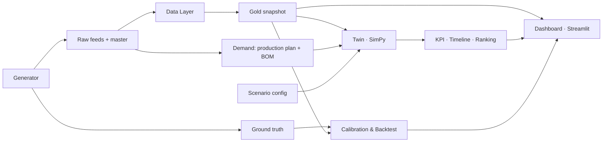

# DENSO LogTwin

Digital Twin Control Tower cho logistics nội bộ nhà máy, phát triển cho bài toán D2 của hackathon DENSO. Dự án kết hợp dữ liệu vận hành, mô phỏng sự kiện rời rạc bằng SimPy và dashboard Streamlit để theo dõi trạng thái, dự báo hàng đợi và so sánh phương án phân bổ tài nguyên.

Luồng vật tư: **Kho → AMR → Packer → AGV → Dây chuyền sản xuất**.

## Chức năng

| Thành phần | Chức năng |
|---|---|
| Generator | Sinh dữ liệu nhà máy giả theo seed: 6 feed, master mapping và ground truth |
| Data Layer | Chuẩn hóa dữ liệu, nối ID, dựng hành trình và snapshot tại `as_of` |
| Twin | Khôi phục công việc đang xử lý (WIP), mô phỏng FIFO và tính KPI |
| Demand & Scenario | Quy đổi kế hoạch sản xuất thành nhu cầu vật tư; chạy baseline và WHAT-IF |
| Dashboard | NOW: trạng thái hiện tại; NEXT: dự báo hàng đợi; WHAT-IF: so sánh và xếp hạng |
| Validation | Hiệu chỉnh mô hình, backtest và hiển thị báo cáo sai số |

**Phạm vi hiện tại:** prototype sử dụng dữ liệu tổng hợp. NOW đọc snapshot gold; NEXT và WHAT-IF chạy Twin từ snapshot, production plan và BOM; Validation đọc báo cáo được sinh riêng.

## Kiến trúc



Cây thư mục, trách nhiệm từng module và sơ đồ chi tiết: [Cấu trúc dự án](docs/project_structure.md).

## Cài đặt

Yêu cầu **Python 3.10+**. Chạy các lệnh từ thư mục gốc repository.

```bash
git clone https://github.com/nguyennhan24/denso-logtwin.git
cd denso-logtwin
python -m venv .venv
```

Kích hoạt môi trường:

```powershell
# Windows PowerShell
.\.venv\Scripts\Activate.ps1
```

```bash
# Linux / macOS
source .venv/bin/activate
```

Cài các thư viện:

```bash
python -m pip install -r requirements.txt
```

## Chạy nhanh

```bash
# 1. Sinh dữ liệu demo
python -m src.generator --seed 42 --date 2026-10-21 --days 1

# 2. Dựng snapshot tại 14:10
python -m src.data_layer --day 21 --seed 42 --as-of 14:10

# 3. Mở dashboard
python -m streamlit run app/streamlit_app.py
```

Mở địa chỉ Streamlit in trong terminal. Trong NEXT và WHAT-IF, chọn kế hoạch `baseline` hoặc `spike_14_16_x3` và seed `42` để khớp dữ liệu demo.

`--day 21` tương ứng `2026-10-21` theo `base_date` trong `config/data_layer.yaml`. Nếu đổi ngày hoặc seed, cần sinh lại raw và snapshot tương ứng.

| Thư mục đầu ra | Nội dung |
|---|---|
| `data/raw/2026-10-21_seed42/` | Feed CSV, master mapping và `_truth/` |
| `data/silver/2026-10-21_seed42/` | Dữ liệu đã chuẩn hóa |
| `data/gold/2026-10-21_seed42/` | Snapshot, hành trình, trạng thái đơn và chất lượng dữ liệu |
| `data/gold/latest/` | Snapshot mới nhất dashboard sử dụng |
| `data/results/` | Kết quả mô phỏng và báo cáo validation |

## Chạy qua CLI

### Mô phỏng WIP hiện tại

```bash
python -m src.twin --state data/gold/latest/state.json --horizon 60 --out data/results/baseline.json
```

Lệnh này chỉ mô phỏng WIP trong snapshot, chưa bổ sung demand tương lai.

### So sánh kịch bản với demand tương lai

```bash
python -m src.demand --day 21 --seed 42 --as-of 14:10 --plan baseline --horizon 60
python -m src.scenario.runner --demand data/gold/2026-10-21_seed42/demand_baseline_1410.json
```

Kết quả được ghi vào `data/results/phase7_scenarios.json`. Horizon của demand phải khớp cửa sổ mô phỏng trong `config/scenarios.yaml` (mặc định 60 phút). Bỏ `--demand` để so sánh kịch bản chỉ với WIP.

### Calibration và backtest

```bash
python -m src.validation.phase8
```

Pipeline sinh bộ dữ liệu train/test riêng, hiệu chỉnh thời gian phục vụ và so sánh mô hình mặc định với mô hình đã hiệu chỉnh. Báo cáo tại `data/results/phase8_validation.json` được dùng trong mục Validation của dashboard.

## Cấu hình và quy ước

| File | Nội dung |
|---|---|
| [config/generator.yaml](config/generator.yaml) | Nhà máy giả, tài nguyên, BOM, thời gian phục vụ và sự cố |
| [config/data_layer.yaml](config/data_layer.yaml) | Đường dẫn, timezone, mapping, freshness và ước lượng trạng thái |
| [config/scenarios.yaml](config/scenarios.yaml) | Horizon, WHAT-IF, trọng số xếp hạng và ngưỡng cảnh báo |
| [config/plans/](config/plans/) | Kế hoạch sản xuất baseline và kịch bản tăng demand |

Contract hiện tại là **v0.1**: `MaterialRequest`, `CurrentLogisticsState`, `ScenarioConfig`, `SimulationResult`. Thời gian mô phỏng tính bằng phút, với snapshot là phút 0; timestamp bên ngoài có timezone. Throughput đếm lượt giao, không đếm tổng số pack.

Data Layer chỉ sử dụng dữ liệu đã biết tại `as_of`; `_truth/` dành cho kiểm thử và validation. Không đổi tên trường, kiểu hoặc đơn vị contract nếu chưa cập nhật version và đặc tả.

## Kiểm thử

```bash
python contracts/validate_contracts.py contracts/mock_v0_1.json
python -m pytest -q
```

## Giới hạn

- Dữ liệu và kết quả validation đến từ Generator, chưa chứng minh độ chính xác trên dữ liệu nhà máy thực tế.
- Twin dùng thời gian phục vụ cố định theo stage; chưa mô hình đầy đủ blocking, chuyến về và sự cố. `quantity` chưa làm thay đổi thời gian phục vụ.
- Một phần trạng thái và thời gian còn lại được ước lượng do độ trễ log.
- NEXT cảnh báo theo độ dài hàng đợi, chưa đánh giá nguy cơ trễ hạn vật tư.
- Backtest replay demand thực tế đã biết, chưa đánh giá độ chính xác của forecast demand.

## License

[MIT](LICENSE).
