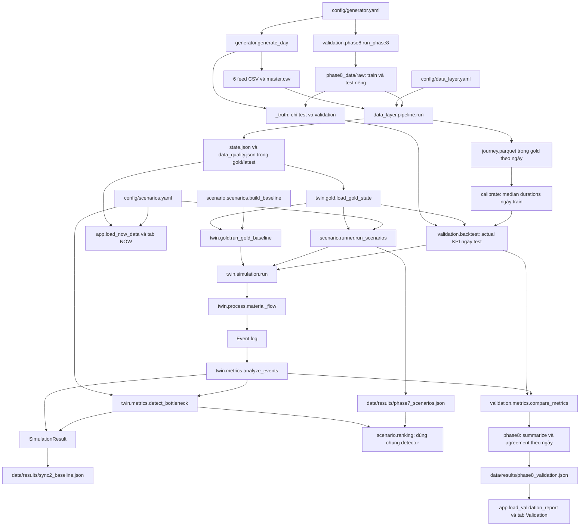

# DENSO LogTwin — Tài liệu hoạt động theo phase

**Đối chiếu code:** 2026-10-09. **Contract hiện tại:** v0.1.

Tài liệu này giải thích code đang có: mỗi file làm gì, mỗi hàm nhận và trả gì, dữ liệu đi qua các module như thế nào. Các phase chưa hoàn tất có phần riêng để cập nhật khi triển khai xong. Việc một module có code không đồng nghĩa toàn bộ gate của phase đã được kiểm chứng.

## Mục lục

- [1. Tổng quan và quy ước](#tong-quan)
- [2. Phase 0 — Contract](#phase-0)
- [3. Phase 1 — World Generator](#phase-1)
- [4. Phase 2 — Twin core](#phase-2)
- [5. Phase 3 — KPI và bottleneck](#phase-3)
- [6. Phase 4 — Unified Data Layer](#phase-4)
- [7. Phase 5 — NOW Dashboard](#phase-5)
- [8. Sync 2 — Nối các phần đã có](#sync-2)
- [9. Phase 6 — Future demand và NEXT](#phase-6)
- [10. Phase 7 — Scenario và WHAT-IF](#phase-7)
- [11. Phase 8 — Backtest và Validation](#phase-8)
- [12. Phase 9 — Tích hợp và demo](#phase-9)
- [13. Cấu hình, test và công cụ hỗ trợ](#ho-tro)
- [14. Cách bổ sung tài liệu](#cap-nhat)

<a id="tong-quan"></a>

## 1. Tổng quan và quy ước

### 1.1. Luồng nghiệp vụ

```text
Kho → AMR chở ra cổng → Packer xử lý → AGV chở tới Line
```

Một `MaterialRequest` là một lượt giao. Trong Twin v0.1, `quantity` không làm tăng thời gian phục vụ: mỗi stage dùng thời gian cố định trong `ScenarioConfig.service_min`. Generator mô phỏng thế giới chi tiết hơn: thời gian pack phụ thuộc số pack, có ngẫu nhiên, nghỉ, hỏng và chuyến về.

### 1.2. Luồng code đang hoạt động



`NOW` đọc state gold, không đọc kết quả Twin. Nó trả lời trạng thái tại `as_of`. Kết quả Twin là diễn biến mô phỏng kể từ snapshot. Hai nguồn này phục vụ hai câu hỏi khác nhau.

Nhánh Phase 8 dùng cùng Generator/Data Layer/Twin nhưng tạo raw và snapshot trong thư mục riêng. Calibration lấy `journey` của ngày train; truth chỉ dùng replay/evaluation ở validation. File Phase 7 chưa được WHAT-IF UI đọc. File Phase 8 đã được Validation UI đọc, không cần UI tự chạy lại batch.

### 1.3. Trạng thái từng phase theo code hiện tại

| Phase | Phần đang có | Phạm vi chưa thể coi là hoàn tất chỉ từ việc có code |
|---|---|---|
| 0 | Spec, fixture, validator, dataclass | Sign-off của cả nhóm là quyết định ngoài code |
| 1 | Sinh feed, master và truth có seed | Đánh giá độ phong phú dữ liệu cho từng kịch bản demo |
| 2 | Twin chạy độc lập, hỗ trợ WIP và gold adapter | Khác biệt vật lý với Generator vẫn được giữ trong v0.1 |
| 3 | KPI theo contract, timeline, bottleneck dùng chung | Cần kiểm tra sau mỗi thay đổi metrics |
| 4 | Pipeline raw → silver → gold | Không suy ra trạng thái toàn hệ thống chỉ từ báo cáo Data Layer cũ |
| 5 | NOW đọc gold, lọc line, nguồn lực, freshness và severity | Kiểm tra UI thực tế là bước xác nhận gate |
| 6 | | |
| 7 | Builder, runner chạy Twin thật, ranking và explanation | WHAT-IF UI còn dùng `fake_results`, chưa đọc kết quả runner |
| 8 | Backtest, calibration train/test, báo cáo DEFAULT/CALIBRATED, test và Validation UI đọc report thật | CALIBRATED đạt gate agreement trên bộ test hiện có; không chứng minh forecast demand hoặc model tại nhà máy thật |
| 9 | NOW đọc gold; Validation đọc báo cáo Phase 8 | NEXT và WHAT-IF chưa được tích hợp đầy đủ; cần xác nhận demo/UI thực tế |

### 1.4. Thuật ngữ cần phân biệt

| Thuật ngữ | Ý nghĩa trong code |
|---|---|
| `as_of` | Timestamp chụp trạng thái. Data Layer chỉ dùng thông tin đã biết tại mốc này |
| `t=0` của Generator | Giờ bắt đầu ngày, mặc định 06:00 |
| `t=0` của Twin có state | Chính thời điểm `as_of`, không phải 06:00 |
| WIP | Các đơn đã có mặt tại snapshot, gồm queued và active |
| `demand` của Twin | Chỉ các request mới sẽ đến trong horizon; không lặp lại WIP |
| `arrival_min` của WIP | Luôn 0 theo contract, kể cả đơn thực tế được tạo trước snapshot |
| `created_offset_min` | Thời điểm tạo so với snapshot, thường âm; metadata lịch sử của Data Layer |
| `remaining_min` | Thời gian tiếp tục active job trong Twin; phải > 0 |
| `est_remaining_min` | Ước lượng để hiển thị NOW; có thể bằng 0 khi overdue |
| `overdue` | Đã quá thời gian phục vụ ước lượng, chưa quan sát thấy khâu kết thúc |
| `late` | Đã quá hạn giao `due_at`; không đồng nghĩa với `overdue` |
| `completion_unconfirmed` | Có thể đã xong nhưng nguồn nhập tay chưa ghi nhận, thường ở packer |
| `resources.amr.busy` | Số active job ở khâu AMR theo contract |
| `resource_counts.amr.busy` | Số robot bận về mặt vật lý, có cả robot đang chạy về |
| `resource_counts.amr.idle` | Số AMR thực sự rảnh; không suy ra bằng `total - resources.busy - offline` |

Giờ trao đổi ra ngoài là ISO 8601 có múi giờ +07:00; thời gian mô phỏng là số phút. Snapshot dữ liệu mẫu có thể mang ngày khác ngày chạy chương trình; NOW hiển thị timestamp của dữ liệu.

<a id="phase-0"></a>

## 2. Phase 0 — Contract chung

**Mục tiêu:** các phần Data, Twin, Decision và UI hiểu cùng tên trường, kiểu dữ liệu và đơn vị.

### 2.1. File liên quan

| File | Vai trò |
|---|---|
| [contracts_v0.1_spec.md](../contracts_v0.1_spec.md) | Quy tắc MaterialRequest, CurrentLogisticsState, ScenarioConfig, SimulationResult và bàn giao |
| [contracts_v0.1_example.json](../contracts_v0.1_example.json) | Ví dụ spec, gồm `material_requests`, `current_logistics_state`, scenario và ordering check |
| [contracts/mock_v0_1.json](../contracts/mock_v0_1.json) | Bundle mock dùng các key `current_state`, `demand`; dùng cho validator và test |
| [contracts/validate_contracts.py](../contracts/validate_contracts.py) | Kiểm request/state và trùng ID trong bundle |
| [contracts/__init__.py](../contracts/__init__.py) | Đánh dấu package; không chứa pipeline nghiệp vụ |
| [src/twin/entities.py](../src/twin/entities.py) | Dataclass để Twin nhận object Python |
| [src/data_layer/contract_check.py](../src/data_layer/contract_check.py) | Model Pydantic và cổng kiểm trước khi ghi gold; giải thích chi tiết ở Phase 4 |

Hai file JSON ví dụ không có cùng tên key ngoài cùng. Không đưa `contracts_v0.1_example.json` trực tiếp vào loader gold, vì loader yêu cầu `contract_version` và `current_state`.

### 2.2. Các hàm trong validator

| Hàm | Đầu vào → đầu ra | Cách hoạt động và chỗ dùng |
|---|---|---|
| `check_request(r, where, horizon_min=None)` | Request dict → list thông báo lỗi | Kiểm ID không rỗng, arrival ≥ 0, quantity nguyên dương; nếu có horizon thì arrival phải < horizon. `where` giúp xác định vị trí lỗi |
| `check_state(s)` | State dict → list lỗi | Kiểm timestamp, đủ ba stage/sáu feed, active job, WIP arrival bằng 0, `busy` khớp số active và `busy + offline ≤ total` |
| `check_bundle(doc, horizon_min=None)` | Bundle → list lỗi | Gọi hai hàm trên, kiểm ID trùng giữa queued, active và demand. Data Layer, gold adapter, NOW và test gọi hàm này |
| Khối `__main__` | Đường dẫn JSON → thông báo/exit code | Chạy validator từ terminal. Lỗi trả exit code 1; hợp lệ trả 0 |

Validator chung kiểm schema request/state. Nó không phải validator đầy đủ cho mọi KPI của `SimulationResult`; KPI được kiểm bằng test riêng.

### 2.3. Dataclass và `__post_init__` của Twin

| Class | Dữ liệu giữ | Kiểm tra khi khởi tạo |
|---|---|---|
| `MaterialRequest` | request ID, arrival, origin, line, material, quantity | Quantity > 0, arrival ≥ 0, request ID không rỗng |
| `ResourceStatus` | total, busy, offline | Các giá trị không âm; busy + offline không vượt total |
| `QueuedJob` | stage và MaterialRequest | Stage thuộc amr/packer/agv |
| `ActiveJob` | stage, remaining_min, MaterialRequest | Stage hợp lệ, remaining_min > 0 |
| `CurrentLogisticsState` | as_of, resources, queued/active, feed_updated_at | Với từng resource, busy phải bằng số active job cùng stage |
| `ScenarioConfig` | scenario ID, horizon, sample interval, seed, capacity, service time | Đúng ba key stage; thời gian và capacity dương |
| `SimulationResult` | metadata run, metrics, timeline, events | Là object kết quả; không có `__post_init__` tự kiểm KPI |

`__post_init__` chạy tự động sau constructor của dataclass. Nó không tự chuyển dict lồng nhau thành dataclass: việc chuyển này nằm trong `gold.py`.

Các model Pydantic cùng tên ở Data Layer là lớp kiểm JSON đầu ra; các dataclass ở Twin là lớp làm việc trong mô phỏng. Hai bộ class có nhiệm vụ khác nhau.

**Gate Phase 0:** nhóm chốt bốn contract v0.1. Tài liệu này mô tả implementation, không thay thế sign-off hoặc quy trình duyệt thay đổi contract.

<a id="phase-1"></a>

## 3. Phase 1 — World Generator

**Owner:** Trung. **Mục tiêu:** tạo một ngày hoạt động giả lập, rồi xuất sáu feed có ID/giờ không đồng nhất để Data Layer xử lý.

### 3.1. Chuỗi gọi chính

```text
generator.__main__
  → generate_days
    → generate_day
      → load_config → build_world
      → make_plan → make_requests
      → run_world
      → build_feeds
      → ghi CSV vào data/raw/<date>/
```

### 3.2. `src/generator/__init__.py` và `__main__.py`

| Hàm/phần | Cách hoạt động |
|---|---|
| `generate_day(seed, date, config_path, out_dir, config)` | Ưu tiên `config` truyền trực tiếp, nếu không thì đọc YAML. Dựng World, tạo plan/request, chạy world và tạo feed. Trả dict DataFrame. Có `out_dir` thì ghi từng bảng thành CSV; `out_dir=None` thì chỉ trả dữ liệu trong bộ nhớ |
| `generate_days(start, n_days, base_seed, **kw)` | Gọi `generate_day` cho các ngày liên tiếp. Ngày i dùng seed `base_seed + i`, nên tái lập được nhưng các ngày không giống nhau |
| `FEED_NAMES` | Danh sách sáu feed chính: wms, amr, agv, production, labor, excel |
| `__main__.py` | Parse `--seed`, `--date`, `--days`, `--out`; gọi `generate_days`. Đây là entry point của `python -m src.generator` |

### 3.3. `src/generator/world.py`

`World` giữ config, date, seed, bộ sinh số `rng`, timestamp bắt đầu và horizon. Các module Generator dùng chung World để không tự tạo nguồn ngẫu nhiên khác.

| Hàm/property | Đầu vào → kết quả và cách dùng |
|---|---|
| `load_config(path)` | YAML → dict; dùng trước khi dựng World |
| `build_world(cfg, date, seed)` | Dựng giờ đầu ngày có timezone, horizon = day_hours × 60 và `numpy.default_rng(seed)`; trả World |
| `World.amr_ids` | Sinh danh sách AMR-01… theo config resources |
| `World.packer_slots` | Sinh danh sách PK-1… là slot đóng gói |
| `World.agv_ids` | Sinh danh sách AGV-01… |
| `World.shift_index(t_min)` | Tìm ca chứa mốc phút t theo khoảng [shift_start, shift_end); ngoài khoảng dùng chỉ số ca cuối |
| `World.worker_at(slot, t_min)` | Từ slot và ca tính ID worker; flow và break event dùng để ghi người thực hiện |
| `World.clock_to_min(hhmm)` | Giờ trong ngày → phút so với `day_start`; dùng cho kế hoạch nghỉ/ca |
| `World.ts(t_min)` | Phút nội bộ → datetime có múi giờ |
| `World.iso(t_min)` | Gọi ts rồi xuất ISO 8601 độ phân giải giây |
| `World.draw(spec)` | Đổi mean/cv thành tham số lognormal rồi lấy mẫu qua World.rng; dùng cho travel, repair và pack |

### 3.4. `src/generator/demand.py`

| Hàm | Cách hoạt động |
|---|---|
| `make_plan(w)` | Duyệt hour_profile và products. planned_qty = base_units_per_hour × hệ số giờ × nhiễu normal, làm tròn và không âm. Trả bảng hour_idx/line/product/planned_qty |
| `make_requests(w, plan)` | Với mỗi material trong BOM: lambda = planned_qty × packs_per_unit / mean_packs_per_trip. Lấy số lượt từ Poisson, arrival rải uniform trong giờ, số pack lấy nguyên ngẫu nhiên. Sort arrival rồi gán PICK-00001… |

`make_requests` là demand của thế giới Generator, có arrival tính từ 06:00. Nó không được đưa nguyên cả ngày vào Twin đang bắt đầu tại một snapshot mà không đổi time origin và bỏ WIP trùng.

### 3.5. `src/generator/flow.py`

| Hàm | Cách hoạt động |
|---|---|
| `run_world(w, requests)` | Dựng SimPy Environment và ba FilterStore chứa ID tài nguyên. Lên lịch fault/break và một process mỗi request. Chạy đến horizon, trả event DataFrame |
| `log(...)` trong run_world | Gom event gồm t_min, stage, event, unit, pick_no và trường bổ sung vào list chung |
| `_request_flow(env, w, r, pools, log)` | Chờ arrival → lấy AMR → chạy ra cổng → chờ slot packer trong khi vẫn giữ AMR → pack → lấy AGV → giao tới line. Ghi mốc cho từng thao tác |
| `_return_trip(env, pool, unit, duration, log, stage)` | Chờ thời gian về, ghi RETURNED rồi trả ID tài nguyên vào pool |

Điểm quan trọng: AMR chỉ được release khi packer nhận thùng, và còn phải chạy về trước khi phục vụ lượt khác. FilterStore quản lý robot/slot cụ thể; Twin v0.1 quản lý số lượng capacity bằng Resource.

### 3.6. `src/generator/breakdown.py`

| Hàm | Cách hoạt động |
|---|---|
| `amr_faults(env, w, amr_pool, log)` | Lấy số fault từ Poisson, mốc hỏng từ uniform và thời gian repair từ World.draw; tạo process `_one_fault` |
| `_one_fault(...)` | Đến mốc hỏng, lấy một AMR khỏi pool, ghi FAULT, chờ repair, ghi RECOVER rồi trả robot. Nếu chưa có xe rảnh thì fault phải đợi, không làm hỏng xe giữa task |
| `worker_breaks(env, w, packer_pool, log)` | Duyệt ca và slot, dùng break_offsets_min để lên lịch nghỉ lệch nhau; tạo process `_one_break` |
| `_one_break(...)` | Đợi đúng slot làm xong rồi giữ slot trong thời gian nghỉ; ghi BREAK_START/BREAK_END |
| `pack_time(w, packs)` | Setup time + tổng thời gian từng pack. Có xác suất nhân hệ số outlier; trả `(duration, is_outlier)` |

### 3.7. `src/generator/feeds.py`

| Hàm | Cách hoạt động |
|---|---|
| `_pick_num(pick_no)` | Tách phần số của PICK-00012 thành 12 để tạo AGV label và Excel pick |
| `build_feeds(w, plan, requests, events)` | Chiếu truth thành dữ liệu từng hệ thống. Trả sáu feed, master và hai bảng truth để generate_day ghi CSV |

| Bảng xuất | Cách tạo và giới hạn quan sát |
|---|---|
| wms | Phiếu kho: PICK ID, created_at, material/line code riêng, qty_packs, need_by |
| amr | Task ID riêng. Chỉ DISPATCH có wms_ref; event tiếp theo mang task_id. FAULT/RECOVER không thuộc request |
| agv | Label PK12, station code riêng; giờ load/deliver là epoch giây. Không xuất chuyến về hoặc fault |
| production | Kế hoạch theo giờ và product, dùng mã line WMS |
| labor | Phân ca và giờ nghỉ kế hoạch; nghỉ thực tế có thể bắt đầu muộn do slot đang làm |
| excel | Mốc pack chỉ HH:MM, entered_at làm tròn lên chu kỳ nhập; có xác suất thiếu dòng |
| master | Mapping `(kind, system, code) → canonical_id`; là bảng tham chiếu, không tính là feed thứ bảy |
| _truth/requests | Request gốc kèm pivot mốc event từng khâu và task ID |
| _truth/events | Event log đầy đủ của world; dành cho test/backtest |

### 3.8. Cấu hình và đầu ra

[config/generator.yaml](../config/generator.yaml) điều khiển ngày/ca, số AMR/worker/AGV, mapping mã, products/BOM, hour_profile, packs_per_trip, service distributions, breakdown và Excel lag/missing.

```powershell
python -m src.generator --seed 42 --date 2026-10-21
```

Đầu ra: `data/raw/2026-10-21/*.csv` và `_truth/`. Data Layer chỉ đọc sáu feed + master. Test chính: `tests/test_generator.py`.

**Gate Phase 1:** generate_day chạy ra một ngày có đủ feed. **Sync 1:** kiểm nối Generator với Twin qua contract; không đồng nghĩa Twin được phép đọc raw trực tiếp.

<a id="phase-2"></a>

## 4. Phase 2 — Twin core

**Owner:** Nhân. **Mục tiêu:** `run(config, demand, initial_state)` chạy độc lập với UI.

### 4.1. Chuỗi gọi chính

```text
ScenarioConfig + MaterialRequest[] + CurrentLogisticsState tùy chọn
  → simulation.run
    → deepcopy input
    → simulate_event
      → validate_inputs
      → make_resources
      → material_flow cho active/queued WIP
      → receive_request cho demand mới
      → env.step đến horizon
    → analyze_events (Phase 3)
    → SimulationResult
```

### 4.2. `src/twin/entities.py`

Các dataclass đã giải thích ở Phase 0. Khối `__main__` đọc `contracts/mock_v0_1.json`, chuyển request/resource/job sang object rồi dựng state và scenario mẫu. Đây là ví dụ chạy riêng, không phải loader gold được app gọi.

### 4.3. `src/twin/resources.py`

`make_resources(env, config)` tạo một `simpy.Resource` cho từng stage, capacity lấy từ `config.capacity`; trả dict pools. `Resource` giới hạn số process được phục vụ đồng thời, nhưng không giữ ID từng robot.

Busy không bị trừ khỏi capacity thêm một lần: active WIP tự request tài nguyên và chiếm slot ở phút 0. Baseline capacity là `total - offline`, không phải số robot idle.

Khối `__main__` dựng environment/config mẫu để kiểm tra pool keys và capacity.

### 4.4. `src/twin/process.py`

`material_flow(env, material_request, pools, config, events, start_stage='amr', remaining_min=None)` là generator function của SimPy; chạy bằng `env.process(...)`, không phải hàm trả ngay kết quả cuối.

1. Nếu bắt đầu ở amr: xin AMR, log queued nếu phải đợi, log start, chờ service time, log finish và release AMR.
2. Nếu bắt đầu ở amr hoặc packer: xin packer rồi làm tương tự.
3. Luôn chạy stage agv tiếp theo, sau đó log `line/delivered`.
4. `remaining_min` chỉ thay duration của stage đầu tiên khi tiếp tục active WIP. Các stage sau dùng service_min đầy đủ.

Twin release AMR trước khi xin packer, không mô phỏng AMR blocked tại cổng/chuyến về như Generator. Đây là giới hạn model hiện tại, không phải dữ liệu idle bị mất khi loader parse JSON.

Các `print` start/end/delivered phục vụ theo dõi terminal. Dữ liệu để tính KPI nằm trong `events`, không được lấy từ nội dung print.

Khối `__main__` chạy một request mẫu qua process. Import `.resources`, `.entities` yêu cầu chạy bằng module.

### 4.5. `src/twin/simulation.py`

| Hàm | Nhận → trả | Cách hoạt động |
|---|---|---|
| `validate_inputs(config, demand, initial_state)` | Input run → không trả dữ liệu; lỗi raise ValueError | Kiểm key capacity/service, arrival trong horizon, ID trùng, busy khớp active, stage hợp lệ, remaining dương và capacity đủ cho active |
| `receive_request(env, request, pools, config, events)` | Request mới → process | Đợi arrival_min, log arrival rồi chạy material_flow từ amr |
| `simulate_event(config, demand, initial_state=None)` | Input run → list event | Dựng env/pools; tạo process active trước queued rồi demand. Queued WIP được log ở t=0. Demand sort theo arrival và ID. Chạy cả event đúng horizon. Cuối cùng loại log queued t=0 bị lặp cho WIP |
| `run(config, demand, initial_state=None)` | Input run → SimulationResult | Deepcopy config/demand/state để tránh chia sẻ mutable data giữa các run. Gọi simulate_event và analyze_events, đóng gói kết quả |
| `make_request(...)` trong khối __main__ | ID/arrival → request mẫu | Helper cho các assertion chạy riêng của file |
| `event_times(...)` trong khối __main__ | Events và bộ lọc → list timestamp | Kiểm mốc queued/start/delivered trong các ca WIP và FIFO |

`simulate_event` dùng `while env.peek() <= horizon: env.step()`, vì event đúng horizon phải được tính vào kết quả. Các job chưa hoàn thành lúc kết thúc vẫn đóng góp busy/queue area đến horizon.

### 4.6. Khởi tạo WIP

| WIP | Cách tiếp tục |
|---|---|
| Active AMR | Chạy phần remaining AMR, sau đó packer và AGV |
| Active packer | Chạy remaining packer, sau đó AGV |
| Active AGV | Chạy remaining AGV rồi giao |
| Queued tại stage S | Giữ nguyên stage, chờ slot và chạy service time đầy đủ của S |

Thứ tự `queued_jobs` là dữ liệu có nghĩa; không sort lại theo request ID. WIP queued phải đứng trước demand mới đến cùng phút 0.

### 4.7. Chạy và test

```powershell
python -m src.twin.simulation
python -m src.twin.process
python -m src.twin.resources
```

Các assertion trong simulation kiểm no-WIP, active/queued AGV, FIFO WIP trước demand t=0, completion và timeline. Test nối gold nằm ở `tests/test_twin_gold.py`.

**Gate Phase 2:** Twin chạy độc lập mà không cần Streamlit. Gold adapter là đường tích hợp bổ sung, được giải thích ở Sync 2.

<a id="phase-3"></a>

## 5. Phase 3 — KPI và bottleneck

**Owner:** Nhân; KPI/bottleneck spec do Cường cung cấp. **Mục tiêu:** từ event log thật của một run tính KPI, timeline và bottleneck.

### 5.1. `src/twin/metrics.py`: từng hàm

| Hàm | Nhận → trả | Cách tính |
|---|---|---|
| `count_completion(demand, initial_state, events)` | Requests/state/events → dict hai KPI count | Delivered dùng set request ID để không đếm lặp. Unfinished = demand count + WIP count - delivered count |
| `sample_times(horizon_min, sample_every_min)` | Hai số phút → list mốc | Kiểm finite/dương, dùng Decimal để tránh sai số bước float. Bao gồm 0 và horizon, kể cả horizon không chia hết interval |
| `build_timeline(config, events, initial_state=None)` | Events/state → list snapshot mô phỏng | Khởi tạo set busy/queued/WIP. Tại mỗi mốc, xử lý toàn bộ event ≤ mốc rồi đếm. Trả queue/completed_count đúng contract cùng các trường chẩn đoán cũ |
| `calculate_wait_times(config, events, initial_state=None)` | Events/state → dict thời gian chờ | Theo dõi queued→start; queued WIP bắt đầu tính chờ từ 0, active WIP bỏ qua lượt start t=0. Chỉ đơn đã giao được dùng tính avg_total_wait_min |
| `calculate_resource_metrics(config, events, initial_state=None)` | Events/state → utilization và queue metrics | Tích phân số busy/queued theo thời gian giữa các nhóm event cùng timestamp. Tính cả khoảng tới horizon, lấy peak sau mỗi nhóm event |
| `accumulate_until(time)` trong resource metrics | Mốc tiếp theo → cập nhật các biến area | Cộng busy_count × duration và queue_count × duration; cập nhật previous_time và peak cho khoảng có duration > 0 |
| `calculate_lead_times(demand, initial_state, events)` | Request arrivals và delivered → avg_lead_time_min | Đơn mới dùng arrival_min; WIP dùng 0. Lấy trung bình delivered-arrival trên các ID đã giao, không có giao thì None |
| `detect_bottleneck(metrics, thresholds=None)` | Metrics, ngưỡng tùy chọn → dict bottleneck | Nếu không truyền ngưỡng, đọc phần bottleneck trong config/scenarios.yaml. Chọn stage stressed theo utilization, secondary theo gap; bổ sung wait contribution và cross-check peak queue |
| `analyze_events(config, demand, initial_state, events)` | Toàn bộ input/event → `(metrics, timeline)` | Lọc event trong [0, horizon], gọi lần lượt count, wait, lead, resource và detector; cuối cùng dựng timeline |

### 5.2. Ba cấu trúc thời gian chờ

Trong `calculate_wait_times`, các biến phục vụ ba cách thống kê khác nhau:

```python
wait_by_stage = {
    "amr": [2, 10],
    "packer": [3],
    "agv": [0],
}

wait_by_request = {"A": 5, "B": 10}

wait_by_request_stage = {
    "A": {"amr": 2, "packer": 3, "agv": 0},
    "B": {"amr": 10, "packer": 0, "agv": 0},
}
```

Nếu chỉ A đã giao:

- `avg_wait_by_stage_min.amr` = 6: trung bình các lượt AMR đã bắt đầu phục vụ, có cả B chưa giao.
- `avg_total_wait_min` = 5: tổng chờ qua các stage, trung bình trên đơn đã giao.
- `avg_wait_contribution_by_stage_min` = amr 2, packer 3, agv 0: đóng góp từng stage trên cùng nhóm đơn đã giao.

Mỗi stage contribution dùng cùng mẫu số là số đơn đã giao. Stage đã diễn ra trước snapshot không cộng lại thời gian quá khứ. Không có đơn giao thì các contribution là None. Bảng chi tiết theo request giúp lọc đúng ID delivered; list theo stage không giữ được thông tin ID để lọc.

`open_queue_wait_min` là tổng thời gian quan sát của các lượt còn đang chờ tại horizon. Nó không được cộng vào KPI trung bình của các đơn đã giao.

### 5.3. KPI đầu ra

| Key | Định nghĩa |
|---|---|
| throughput_count | Số request đã giao trong horizon, gồm WIP |
| unfinished_count | Tổng input mới + WIP trừ throughput |
| avg_total_wait_min | Trung bình tổng chờ của các request đã giao |
| avg_lead_time_min | Trung bình delivered-arrival; WIP đo từ snapshot |
| utilization[stage] | Busy resource-minutes / (capacity × horizon) |
| peak_queue[stage] | Queue lớn nhất qua các nhóm event, không chỉ tại các mốc sample |
| avg_queue_length[stage] | Queue-minutes / horizon |
| avg_wait_by_stage_min | Trung bình chờ của các lượt stage đã start, kể cả request chưa giao |
| avg_wait_contribution_by_stage_min | Đóng góp chờ từng stage trên các request đã giao |
| open_queue_wait_min | Tổng chờ còn mở của từng stage tại horizon |
| queue_length_end / busy_end | Số queued/busy tại cuối horizon |
| bottleneck | Primary/secondary, utilization, peak queue, wait contribution, explanation |

KPI thời gian không có mẫu được xuất JSON null, không phải 0. Tên contract là `avg_total_wait_min` và `peak_queue`; không dùng tên cũ `avg_wait_min`, `peak_queue_length` làm đầu ra thay thế.

### 5.4. Timeline và event

Timeline có `time_min`, `queue`, `completed_count`. Hiện code giữ thêm `queue_length`, `delivered_count`, `busy`, `unfinished_arrived_count` để hỗ trợ chẩn đoán và các assertion đã có.

Event có `time_min`, `request_id`, `stage`, `event`; các event nghiệp vụ là arrival, queued, start, finish, delivered. Delivered dùng stage line. Việc xử lý toàn bộ event cùng timestamp trước khi lấy sample tránh coi chuyển stage tức thời là một trạng thái chờ kéo dài.

### 5.5. Bottleneck kết nối Decision thế nào?

```text
Twin.run → analyze_events → metrics và metrics.bottleneck
                             │
                             └→ ranking.detect_bottleneck(metrics)
                                  → twin.metrics.detect_bottleneck
                                  → BottleneckResult dataclass
```

Twin detector trả dict để ghi JSON. Wrapper trong `src/scenario/ranking.py` chuyển dict thành `BottleneckResult`; không có hai thuật toán độc lập. Tham số events ở wrapper giữ tương thích API, hiện không được dùng để tính lại wait vì Twin đã xuất contribution.

Stage có utilization ≥ utilization_stressed mới là ứng viên primary. Secondary là stage stressed thứ hai khi gap ≤ secondary_gap. Peak queue của stage khác lớn hơn primary và đạt peak_queue_severe tạo lời giải thích ùn tắc cục bộ. Có hàng đợi ngắn hạn không tự động làm primary khác nếu không đạt ngưỡng utilization.

Các ngưỡng detector đang đọc là utilization_stressed, secondary_gap và peak_queue_severe. Những key khác trong config không có nghĩa đã được mọi hàm sử dụng.

**Gate Phase 3:** Twin → KPI → bottleneck hoạt động cho một scenario. Test chính: `tests/test_twin_metrics.py` và `tests/test_scenario.py`. Nguồn thiết kế: [kpi_bottleneck_spec.md](kpi_bottleneck_spec.md).

<a id="phase-4"></a>

## 6. Phase 4 — Unified Data Layer

**Owner:** Trung. **Mục tiêu:** tái dựng trạng thái quan sát được tại as_of từ sáu feed; không chạy mô phỏng tương lai và không đọc truth.

### 6.1. Pipeline bảy bước

```text
raw + master
  → ingest: đọc, parse giờ, cắt thông tin chưa biết
  → validate: kiểm từng dòng, cách ly lỗi
  → mapper: chuẩn hóa ID, nối feed, dựng journey
  → state_builder: order_status, fleet, CurrentLogisticsState
  → freshness: theo nguồn và theo đơn
  → quality: số dòng/lỗi/nối ID/ước lượng
  → contract_check: kiểm output rồi ghi gold
```

Silver được ghi sau validate, trước mapper và contract check. Nếu contract check thất bại, gold mới không được ghi nhưng silver có thể đã được ghi. Vì vậy không dùng việc có silver làm bằng chứng gold hợp lệ.

### 6.2. `src/data_layer/__init__.py` và `__main__.py`

| Phần | Cách hoạt động |
|---|---|
| `FEEDS`, `STAGES` | Danh sách nguồn và ba khâu dùng chung trong Data Layer |
| `load_config(path)` | Đọc config/data_layer.yaml bằng safe_load |
| `__main__.py` | Parse day/seed/as-of/raw-dir/config; tính date = base_date + day - 1; kiểm raw tồn tại; gọi pipeline.run; in số đơn/nguồn lực/chất lượng và nơi ghi |

`--seed` của CLI Data Layer chỉ tham gia tên thư mục output. Nó không sinh lại raw hoặc kiểm seed thật của raw; Generator mới là nơi quyết định seed dữ liệu.

### 6.3. `src/data_layer/ingest.py`

| Hàm/class | Cách hoạt động |
|---|---|
| `IngestResult` | Giữ feeds, master, report đếm dòng và quarantine của exact duplicate |
| `parse_iso(s, tz)` | Parse từng ô ISO; naive timestamp coi là giờ địa phương, timestamp có timezone thì convert. Không parse được → NaT |
| `one(x)` trong parse_iso | Xử lý một ô và bắt lỗi kiểu/giá trị; giữ dtype datetime có timezone cho cả Series |
| `parse_epoch(s, tz)` | Coerce sang số, hiểu là giây UTC rồi convert về timezone cấu hình |
| `parse_hhmm(s, day, tz)` | Kiểm định dạng/giới hạn HH:MM[:SS], ghép với ngày snapshot |
| `one(x)` trong parse_hhmm | Parse một ô theo regex, từ chối giờ/phút/giây ngoài giới hạn |
| `to_as_of(as_of, tz)` | Chuẩn hóa đầu vào as_of thành Timestamp có timezone |
| `read_feed(raw_dir, name)` | Đọc một CSV với dtype=str, thêm row_ref như amr.csv:12 để truy nguồn; thiếu file raise FileNotFoundError |
| `read_master(raw_dir)` | Đọc master.csv dạng chuỗi |
| `ingest(raw_dir, as_of, cfg)` | Đọc đúng sáu feed + master, đổi giờ, loại dòng chưa biết và mask ô event tương lai. Loại exact duplicate nhưng ghi lý do vào quarantine; stable-sort feed theo mốc phù hợp |

Các hằng số `COLUMNS`, `TIME_COLUMNS`, `EVENT_TIME_COLUMNS`, `CUT_COLUMN`, `PUBLISH_COLUMN` mô tả schema và chính sách thời gian.

| Feed | Dòng được biết khi nào? | Cắt ô tương lai thế nào? |
|---|---|---|
| wms | created_at ≤ as_of | Không cắt need_by vì đó là hạn kế hoạch |
| amr | ts ≤ as_of | Mỗi dòng là một event |
| agv | load_epoch ≤ as_of | Giữ dòng đã load nhưng xóa deliver_epoch nếu chưa giao |
| excel | entered_at ≤ as_of | Không dùng end để giả vờ đã biết nội dung trước lúc nhập |
| production/labor | Kế hoạch giả định công bố ở mốc đầu bảng | Giữ giờ kế hoạch tương lai vì đã được công bố |

Timestamp lỗi vẫn giữ dòng cho validate cách ly, thay vì âm thầm loại bỏ như một dòng tương lai.

### 6.4. `src/data_layer/validate.py`

| Hàm | Nhận → trả và cách hoạt động |
|---|---|
| `_minutes(a, b)` | Hai Series datetime → (b-a) tính bằng phút |
| `_outside(values, rng)` | Đánh dấu giá trị có thật nằm ngoài khoảng min/max; ô thiếu được kiểm ở bước khác |
| `validate_feed(name, df, cfg)` | Một feed → `(clean, quarantine)`. Kiểm đủ cột, required, integer, range và event domain; chuẩn hóa event AMR uppercase và cột số sạch thành integer |
| `flag(mask, check, reason)` trong validate_feed | Ghi từng row_ref vi phạm vào issues. Một dòng có thể có nhiều lỗi nên quarantine có thể nhiều dòng cho một row_ref |
| `validate_all(feeds, cfg)` | Chạy validate_feed cho sáu feed, trả dict clean và quarantine gộp |
| `write_silver(clean, quarantine, out_dir)` | Tạo thư mục, ghi sáu Parquet giữ timezone và quarantine.csv; trả output Path |

`REQUIRED` là cột bắt buộc theo feed; `INTEGER_COLUMNS` xác định cột số nguyên. `AMR_EVENTS` là domain event; `RESOURCE_EVENTS` = FAULT/RECOVER. Các ID bị lệch dạng được để mapper xử lý, không loại sớm ở validate.

### 6.5. `src/data_layer/mapper.py`

| Hàm/class | Cách hoạt động |
|---|---|
| `_number(value, pattern)` | Lấy số nguyên dương từ ID/regex, xử lý khoảng trắng/case và dạng .0; không hiểu → None |
| `normalize_request_id(value)` | PICK-00012, PK12, 12… → PICK-00012 |
| `normalize_task_id(value)` | T-0007, t7, T0007… → T-0007 |
| `code_maps(master)` | Gom master thành dict theo `(kind, system)` để map mã line/material |
| `LinkResult` | Giữ linked tables, quarantine và stats tỷ lệ nối |
| `_reject(df, mask, feed, check, reason, sink)` | Ghi dòng không nối được vào quarantine và trả phần còn lại |
| `link_feeds(clean, master, cfg)` | Dùng WMS làm tập request gốc, nối AMR qua DISPATCH/task_id, nối AGV/Excel qua số phiếu; kiểm duplicate, mã master và line AGV khớp WMS |
| `_minutes(a, b)` | Thời lượng giữa hai mốc đã biết |
| `build_journey(linked, as_of, cfg)` | Một request WMS một dòng: các mốc từng khâu, IDs, due, durations và current_stage |
| `lookup(table, col)` trong build_journey | Reindex cột theo request_id của journey; giữ dtype datetime kể cả bảng nguồn rỗng |
| `amr_event(name)` trong build_journey | Chọn event AMR theo tên và lấy một dòng cho mỗi request |
| `print_link_stats(stats)` | In tỷ lệ nối overall và amr/agv/excel; không thay đổi bảng dữ liệu |

Chuỗi ID:

```text
WMS pick_no → request_id chuẩn
AMR DISPATCH.wms_ref → task_id → ARRIVE_GATE/RELEASE/RETURNED
AGV label PK12 → request_id PICK-00012
Excel pick 12 → request_id PICK-00012
master line/material code → canonical ID
```

FAULT/RECOVER là event robot nên không cần request_id để được giữ lại. AMR stable-sort để bảo toàn thứ tự RETURNED rồi DISPATCH nếu feed ghi cùng một giây.

`build_journey` chọn mốc xa nhất quan sát được: delivered → agv_active → agv_queued → packer_active → packer_queued → amr_active; nếu chưa có DISPATCH thì amr_queued. RELEASE được dùng làm packer_start_at, vì thùng được lấy khỏi AMR lúc này; packer_end_at lấy từ Excel.

### 6.6. `src/data_layer/state_builder.py`

| Hàm | Cách hoạt động |
|---|---|
| `_minutes_until(start, as_of)` | Số phút từ mốc start đến snapshot |
| `amr_fleet_status(amr, cfg)` | Lấy event gần nhất mỗi robot rồi map qua amr_status_by_event. Fleet bao gồm danh sách config và ID quan sát được; chưa có event thì idle |
| `amr_current_request(amr)` | Request của event gần nhất mỗi AMR; fault/recover có thể trả None. Dùng nối blocked robot với thùng đang giữ |
| `agv_fleet_status(agv, cfg)` | Job gần nhất load chưa deliver → busy, đã deliver → idle; không suy ra fault/chuyến về vì feed không có |
| `packer_workers(labor, as_of)` | Từ ca/nghỉ kế hoạch trả slots, on_shift, on_break và available |
| `stage_estimates(journey, cfg)` | Trung vị duration của những lượt đã có đủ mốc trước as_of. Dưới min_samples dùng fallback config. Trả median_min, samples và method từng stage |
| `build_order_status(journey, as_of, estimates, cfg, n_packer_slots)` | Lấy đơn đã tạo và chưa giao; xác định stage/status, FIFO, queue position, thời gian ở khâu, remaining estimate, overdue/late và cờ ước lượng |
| `_request(row)` | Tạo MaterialRequest dict đúng contract; WIP arrival_min = 0, quantity là int |
| `_created_offset_min(row, as_of)` | Thời gian tạo so với snapshot, làm tròn phút; thường âm |
| `build_state(order_status, amr_status, agv_status, workers, as_of, cfg, amr_requests)` | Đóng gói queued/active, resources, resource_counts/detail, blocked_jobs và open_request_count |
| `group(status, kinds)` trong build_state | Gom ID tài nguyên theo busy/blocked/idle/offline |
| `counts(groups, total)` trong build_state | Biến các nhóm ID thành số đếm vật lý và total |

`DURATION_OF_STAGE` chọn cột để ước lượng; `ENTERED_AT` chọn mốc vào từng trạng thái; `STAGE_END_FEED` xác định khâu có mốc kết thúc từ manual feed hay stream.

Khi Excel trễ khiến số packer_active lớn hơn số slot, `build_order_status` chuyển các đơn bắt đầu sớm nhất sang agv_queued và gắn stage_is_estimated. Đây là suy luận có cờ, không phải event PACK_DONE đã quan sát.

Đơn active có remaining estimate = median - elapsed. Khi ≤ 0, est_remaining_min = 0 và overdue = true. `build_state` vẫn xuất remaining_min dương theo contract bằng floor cấu hình, mặc định 0.5 phút. Nếu mốc kết thúc đến từ manual feed thì đặt completion_unconfirmed.

Packer offline dựa vào lịch và được kẹp để busy + offline không vượt total. Giá trị `wait_min` trong order_status hiện là tuổi đơn kể từ created_at, không phải KPI queued→start của Twin.

### 6.7. `src/data_layer/freshness.py`

| Hàm | Cách hoạt động |
|---|---|
| `_last_update(name, df, as_of)` | Với stream/manual: lấy event/entered_at mới nhất ≤ as_of. Với plan/labor: lấy mốc công bố giả định đầu bảng |
| `source_freshness(feeds, as_of, cfg)` | Tính source_type, last_update, age_min, stale_after_min, stale. Dùng feed sau ingest trước validate vì dòng lỗi vẫn chứng tỏ nguồn đang gửi |
| `attach_source_freshness(state, fresh, as_of, cfg)` | Gắn source_freshness và đủ sáu feed_updated_at. Nguồn chưa có dữ liệu dùng day_start không sau as_of, vẫn stale=true |
| `add_order_freshness(order_status, journey, as_of, cfg)` | Lấy event mới nhất từng request rồi thêm last_update_at, age_min, stale vào order_status |

Freshness đo so với `as_of`, không phải thời gian hiện tại của máy. Bấm refresh UI chỉ đọc lại gold; không tự gọi pipeline hoặc làm timestamp tiến lên.

### 6.8. `src/data_layer/pipeline.py`

| Hàm/class | Cách hoạt động |
|---|---|
| `PipelineResult` | Object giữ as_of, feed ingested, clean, quarantine, link_stats, journey, order_status, state_doc, quality và gold_dir |
| `build_quality_report(...)` | Gom số dòng raw/cắt/trùng/sạch, lỗi theo lý do/feed, tỷ lệ nối, tỷ lệ estimated và số overdue/late/stale |
| `run(raw_dir, as_of, cfg=None, out_name=None, write=True, verbose=True)` | Điều phối bảy bước. write=True ghi silver/gold/latest; write=False vẫn kiểm output nhưng không ghi. verbose điều khiển print link stats |

`state_doc` là dict ngoài cùng `{"contract_version": "0.1", "current_state": state}`. `quality` là báo cáo riêng; `journey` có cả đơn đã giao lẫn đơn mở, còn `order_status` chỉ có đơn mở.

`quarantine_total` đếm số bản ghi lỗi trong bảng quarantine. Một dòng raw có nhiều lỗi có thể tạo nhiều bản ghi; số dòng raw bị cách ly theo feed được đếm riêng bằng row_ref duy nhất trong báo cáo. Không đồng nhất hai số này.

### 6.9. `src/data_layer/contract_check.py`

| Class/model | Kiểm gì? |
|---|---|
| `ContractError` | Exception báo output sai; caller không tiếp tục ghi gold |
| `MaterialRequest` | ID không rỗng, arrival không âm, quantity StrictInt > 0; cấm extra key |
| `ResourceStatus` | total/busy/offline là StrictInt không âm; cấm extra key |
| `ResourceStatus.busy_plus_offline_le_total()` | Busy + offline ≤ total |
| `QueuedJob` | Stage hợp lệ, request hợp lệ, created_offset_min ≤ 0; cho metadata extra |
| `QueuedJob.wip_arrival_zero()` | WIP arrival_min = 0 |
| `ActiveJob` | Stage/remaining/request và metadata estimate/overdue/unconfirmed |
| `ActiveJob.check()` | WIP arrival=0, estimated=true, overdue khớp est_remaining_min=0, unconfirmed chỉ khi overdue |
| `CurrentLogisticsState` | as_of và feed timestamps có timezone; nested resource/job models |
| `CurrentLogisticsState.check()` | Đủ stage/feed, update không sau as_of, busy khớp active, ID không trùng |
| `StateFile` | Version đúng 0.1 và current_state hợp lệ |

| Hàm | Cách hoạt động |
|---|---|
| `check_outputs(state_doc, order_status)` | Pydantic validate, gọi validator chung khi import được, kiểm resource extras và cờ/method ước lượng của order_status. Gom lỗi rồi raise ContractError |
| `_check_resource_extras(st)` | Kiểm số đếm vật lý cộng thành total, list ID khớp count, blocked_jobs khớp robot blocked, total/offline khớp contract |
| `_write_json(path, doc)` | Ghi JSON UTF-8, giữ tiếng Việt và indent |
| `write_gold(gold_dir, hhmm, state_doc, order_status, journey, quarantine, quality, latest_dir)` | Gọi check_outputs trước khi tạo/ghi gold. Ghi snapshot và bản latest; trả gold_dir |

Trong code, `check_outputs` bỏ qua validator chung nếu import không được, nhưng vẫn chạy Pydantic và kiểm extras. Môi trường repo bình thường có package contracts nên validator chung được gọi. Twin/NOW loader dùng validator chung, không dùng toàn bộ model estimate của Data Layer.

### 6.10. File đầu ra và chỗ dùng

| File | Người đọc và ý nghĩa |
|---|---|
| data/silver/<name>/*.parquet | Feed sạch sau validate; phục vụ kiểm dữ liệu, chưa phải state chuẩn |
| data/silver/<name>/quarantine.csv | Lỗi ở ingest/validate, chưa gồm lỗi mapper |
| data/gold/<name>/state_HHMM.json | Snapshot contract tại một mốc |
| data/gold/<name>/order_status_HHMM.parquet | Bảng đơn mở với FIFO, estimate, overdue/late/stale |
| data/gold/<name>/journey.parquet | Bảng lịch sử quan sát được tại lần chạy gần nhất trong thư mục đó; ghi đè khi chạy mốc khác |
| data/gold/<name>/quarantine.csv | Lỗi gộp ingest + validate + mapper |
| data/gold/<name>/data_quality_HHMM.json | Báo cáo chất lượng cho mốc đó |
| data/gold/latest/state.json | Gold adapter và NOW cùng đọc |
| data/gold/latest/order_status.parquet | Bản order_status gần nhất, sẵn cho consumer dùng; NOW hiện đọc job trực tiếp từ JSON |
| data/gold/latest/data_quality.json | NOW đọc và kiểm as_of khớp state |

`latest` là lần pipeline chạy gần nhất, không nhất thiết là timestamp lớn nhất nếu vừa chạy lại một mốc quá khứ. Các file latest ghi tuần tự, không phải transaction nhiều file; NOW phát hiện state/quality khác as_of và yêu cầu refresh lại.

```powershell
python -m src.data_layer --day 21 --seed 42 --as-of 14:10
```

**Gate Phase 4:** consumer đọc state chuẩn, không tự nối raw. Test chính: `tests/test_data_layer.py`. Tài liệu sâu hơn: [phase4_data_layer.md](phase4_data_layer.md), [data_dictionary.md](data_dictionary.md), [contract_change_proposal.md](contract_change_proposal.md).

<a id="phase-5"></a>

## 7. Phase 5 — NOW Dashboard

**Owner UI:** Hải Anh; phần nối dữ liệu đã được bổ sung trong quá trình Sync 2. **Mục tiêu:** hiển thị trạng thái tại snapshot từ gold.

### 7.1. File và vòng đời Streamlit

[app/streamlit_app.py](../app/streamlit_app.py) chứa cấu hình trang/CSS, loader, sidebar, các nhánh NOW/NEXT/WHAT-IF/Validation và một loader timeline cũ ở cuối file.

```text
Streamlit chạy script từ trên xuống
  → load_now_data
  → state + quality + thresholds
  → sidebar chọn menu qua st.session_state
  → nhánh UI tương ứng
  → tương tác widget/rerun làm script chạy lại
```

`ROOT` được tính từ vị trí file app, `GOLD_DIR = ROOT/data/gold/latest`, nên loader không phụ thuộc working directory để tìm gold. Một số nhánh cũ khác vẫn dùng đường dẫn tương đối; khi chạy app nên đứng ở root repo.

### 7.2. Từng hàm trong file app

| Hàm | Hoạt động và tình trạng |
|---|---|
| `load_now_data()` | Đọc state.json, kiểm version và check_bundle; đọc quality và so as_of; đọc exception_severity từ config. Trả `(state, quality, thresholds)`. Không cache, không fallback mock |
| `belongs(job)` trong nhánh NOW | Kiểm line đích của job khớp selectbox hoặc đang chọn toàn nhà máy. Dùng lọc queued/active; không lọc fleet dùng chung theo line |
| `load_mock_simulation_timeline()` | Trả bảng timeline viết sẵn, có cache_data. Hiện không phải nguồn dữ liệu của nhánh NEXT đang chạy |
| `load_validation_report()` | Đọc data/results/phase8_validation.json; kiểm report_version=0.1 và đủ model DEFAULT/CALIBRATED. Có `st.cache_data`; xem luồng sử dụng và refresh ở Phase 8 |
| `load_simulation_result_timeline()` | Đọc data/results/simulation_timeline.json nếu có và có thể fallback timeline mẫu; hiện chưa được nhánh NEXT gọi. Nó cũng không đọc trực tiếp SimulationResult bundle từ sync2_baseline.json |

Khối try/except khi load gold hiển thị lỗi rồi st.stop nếu thiếu file, sai schema, version hoặc snapshot không khớp. Do loader chạy trước menu, thiếu gold sẽ ngăn cả app tiếp tục, không chỉ NOW.

### 7.3. NOW hiển thị gì?

| Thành phần UI | Nguồn/tính toán |
|---|---|
| Snapshot | state.as_of |
| Bộ lọc line | Các destination_line_id có trong đơn đang mở; không phải danh sách toàn bộ line của nhà máy |
| Đơn mở | Số selected_queued + selected_active |
| Đơn đang chờ/phục vụ | Đếm từ hai list tương ứng sau lọc |
| AMR idle/blocked | resource_counts.amr, theo toàn nhà máy |
| Luồng AMR/Packer/AGV | Đếm queued/active từng stage theo line đã chọn |
| Resource table | resources: total, offline, số active job, tỷ lệ busy/online |
| Remaining estimate | active_jobs.est_remaining_min; queued không có estimate thì để trống |
| Ghi chú unconfirmed | completion_unconfirmed có ưu tiên trước overdue |
| Freshness | source_freshness: source type, last_update, age_min, stale |
| Quality panel | quarantine_total, overall link rate, tỷ lệ đơn có estimate |

NOW không lấy KPI lead time/throughput tương lai của Twin để gắn nhãn thành số liệu thực tế của snapshot. Các số mock wait/throughput và bản đồ ngẫu nhiên ở nhánh NOW đã được thay bằng thông tin state quan sát được.

### 7.4. Exception severity

Tỷ lệ bận stage = busy / (total - offline), lấy từ state live/snapshot. Nếu online bằng 0 thì tỷ lệ tính 0 để tránh chia cho 0; việc có offline vẫn kích hoạt CRITICAL.

Code xét toàn nhà máy theo thứ tự:

1. CRITICAL nếu có resource offline, hoặc tỷ lệ bận cao nhất ≥ critical_utilization_min, hoặc tổng queued > critical_queue_min.
2. WARNING nếu chưa critical và tỷ lệ bận cao nhất ≥ warning_utilization_min, hoặc queued ≥ warning_queue_min.
3. Còn lại NORMAL.

Với config hiện tại, các ngưỡng tương ứng là 0.90, >8, 0.70 và ≥4. Các key normal_* trong YAML hiện không được nhánh NOW đọc trực tiếp; NORMAL là nhánh còn lại của hai điều kiện trên.

Severity NOW là trạng thái tại một mốc. Bottleneck Twin dùng utilization tích lũy cả horizon. NOW có thể CRITICAL trong khi Twin baseline WIP-only 60 phút không có primary bottleneck; hai kết luận không mâu thuẫn.

### 7.5. Ví dụ snapshot để đối chiếu

Ngày 2026-10-21, seed 42, as_of 14:10:

| Phạm vi | Đơn mở | Queued | Active |
|---|---:|---:|---:|
| Toàn nhà máy | 13 | 6 | 7 |
| L1 | 7 | 3 | 4 |
| L2 | 6 | 3 | 3 |

AMR vật lý idle=0, blocked=2. Packer có 3 active trên 3 online nên severity CRITICAL. Đây là ví dụ dữ liệu mẫu, không phải giá trị phải hardcode vào UI.

Refresh đọc lại file, không gọi Generator/Data Layer/Twin. Muốn snapshot khác phải chạy pipeline cho as_of khác rồi refresh.

```powershell
python -m streamlit run app/streamlit_app.py
```

**Gate Phase 5:** demo NOW hoàn chỉnh với state thật. Cần kiểm giao diện trong trình duyệt, filter và refresh; việc loader/function chạy đúng không thay thế kiểm tra này.

<a id="sync-2"></a>

## 8. Sync 2 — Gold → Twin và NOW

Sync 2 là mốc tích hợp Data Layer hoàn thành với Twin chuẩn bị freeze. Phạm vi xác nhận là gold → Twin và NOW; runner/Validation được bổ sung ở Phase 7–8 và không thay thế các kiểm tra Sync 2.

### 8.1. `src/twin/gold.py`

| Hàm | Cách hoạt động |
|---|---|
| `load_gold_state(path)` | Đọc bundle JSON, yêu cầu version 0.1 và current_state dict, gọi check_bundle rồi dựng dataclass resource/request/job/state. Giữ nguyên thứ tự queued_jobs |
| `run_gold_baseline(path, horizon_min=60, sample_every_min=5, seed=42, service_min=None)` | Nạp state, chuyển resource dataclass sang dict cho build_baseline của Decision; dựng ScenarioConfig rồi gọi run với demand=[] và initial_state thật |

Metadata extra ở cấp job/state không bị unpack thẳng vào dataclass. Loader chọn stage, remaining_min, request… cần thiết, nên các trường estimated/freshness không làm constructor lỗi. Request và ResourceStatus vẫn dùng `**dict` của contract; Data Layer kiểm chúng không có extra key.

`run_gold_baseline` chỉ tiếp tục WIP. `input_count=0` nghĩa là không có request mới, không có nghĩa không có 13 đơn đang mở. `initial_state_used=true` xác nhận đã khởi tạo từ snapshot.

Service mặc định hiện lấy từ implementation `build_baseline` trong scenarios.py: amr=5, packer=4, agv=3. Hàm này chưa tự đọc default_service_min từ YAML, dù config có các số tương ứng. Có thể truyền service_min vào API để dùng giá trị khác; CLI Twin hiện không có flag service riêng.

### 8.2. `src/twin/__main__.py`

`main()` parse các flag sau, gọi run_gold_baseline, dùng dataclasses.asdict chuyển kết quả sang dict rồi ghi JSON UTF-8:

| Flag | Mặc định | Ý nghĩa |
|---|---|---|
| --state | data/gold/latest/state.json | Snapshot đầu vào |
| --out | data/results/sync2_baseline.json | SimulationResult đầu ra |
| --horizon | 60 | Số phút chạy từ snapshot |
| --sample-every | 5 | Khoảng cách sample timeline |
| --seed | 42 | Seed trong ScenarioConfig; Twin hiện dùng service cố định nên chưa lấy mẫu random |

Lỗi đọc/parse/schema/construction/simulation ở nhóm exception được bắt thì CLI thoát code 1; kết quả thành công được ghi file và in count summary.

### 8.3. Luồng thao tác đầy đủ

Chạy tại root repo, trong Python environment đã cài requirements:

```powershell
python -m src.generator --seed 42 --date 2026-10-21
python -m src.data_layer --day 21 --seed 42 --as-of 14:10
python -m src.twin --state data/gold/latest/state.json --out data/results/sync2_baseline.json
python -m streamlit run app/streamlit_app.py
```

Ba lệnh đầu chạy tuần tự để dữ liệu đã có trước khi consumer đọc. App đọc gold trực tiếp, không cần lệnh Twin để NOW hiển thị; chạy Twin là kiểm nhánh mô phỏng cùng snapshot.

Ví dụ với snapshot trên, baseline WIP-only 60 phút có throughput=13, unfinished=0, avg_total_wait≈2.353846, avg_lead_time≈10.653846, peak_queue amr=2/packer=4/agv=0. Primary bottleneck có thể None do utilization bình quân không đạt 80% trong cả horizon.

### 8.4. Xác nhận Sync 2

- [ ] Validator nhận state gold, ID WIP không trùng và thứ tự queue giữ nguyên.
- [ ] Twin dùng initial_state thật, continuation active và offline capacity đúng v0.1.
- [ ] KPI đúng tên contract, lead/wait có null khi không có đơn giao.
- [ ] Decision dùng cùng detector với Twin.
- [ ] NOW dùng gold, đúng snapshot/count, hiển thị estimated/unconfirmed/freshness.
- [ ] Test liên quan và kiểm UI đã được chạy sau thay đổi cuối cùng.

Checkbox là nơi ghi kết quả xác nhận của nhóm, không được đánh dấu chỉ vì tài liệu được tạo.

### 8.5. Giới hạn v0.1 đang giữ

AMR blocked/return trips không được Twin core mô phỏng; offline capacity cố định theo snapshot, chưa có lịch recover trong horizon. Active remaining là estimate, job overdue dùng floor kỹ thuật. Lead time của WIP đo từ snapshot, không hồi phục toàn bộ tuổi đơn thực tế. Thay đổi ý nghĩa contract cần được nhóm duyệt theo [contract_change_proposal.md](contract_change_proposal.md), không tự coi là việc bắt buộc thêm để chốt Sync 2.

Nếu một stage hoàn toàn offline, baseline capacity của stage đó bằng 0 và ScenarioConfig hiện từ chối vì v0.1 yêu cầu capacity > 0. Adapter không tự tạo capacity giả để chạy trường hợp này.

<a id="phase-6"></a>

## 9. Phase 6 — Future demand và NEXT

<a id="phase-7"></a>

## 10. Phase 7 — Scenario và WHAT-IF

**Owner:** Cường phần comparator/ranking/explanation; Nhân phần runner. **Trạng thái:** backend đã chạy từng scenario qua Twin; WHAT-IF UI vẫn dùng kết quả mẫu.

### 10.1. File và luồng kết nối

| File | Vai trò |
|---|---|
| [src/scenario/scenarios.py](../src/scenario/scenarios.py) | Dựng baseline và các cấu hình thay đổi tài nguyên/thời gian phục vụ |
| [src/scenario/runner.py](../src/scenario/runner.py) | Chạy các config trên cùng snapshot/demand; có API và CLI ghi kết quả |
| [src/scenario/ranking.py](../src/scenario/ranking.py) | So KPI, tính điểm, delta, bottleneck và giải thích |
| [config/scenarios.yaml](../config/scenarios.yaml) | Horizon, interval, service mặc định, 10 definition WHAT-IF, ranking weights và thresholds |
| [app/streamlit_app.py](../app/streamlit_app.py) | Nhánh WHAT-IF hiện gọi ranking với `fake_results`; chưa nối runner |

```text
state.json → load_gold_state → CurrentLogisticsState → asdict
config/scenarios.yaml → build_baseline → build_whatif_scenarios
  → ScenarioConfig cho BASELINE và từng WHAT-IF
JSON demand (nếu có) → check_bundle → MaterialRequest
configs + cùng demand/state → run_scenarios
  → Twin.run từng config → asdict(SimulationResult)
  → dict scenario_id → result → phase7_scenarios.json
  → rank(results, weights) khi caller gọi thêm → bảng xếp hạng/giải thích
```

CLI runner chỉ chạy và ghi kết quả, chưa tự gọi `rank` hay cập nhật UI. `rank` nhận được chính dict mà runner trả về hoặc JSON đã đọc lại.

### 10.2. Từng hàm trong `scenarios.py`

| Hàm | Nhận → trả và cách hoạt động |
|---|---|
| `build_baseline(state, horizon_min=60, sample_every_min=5, seed=42, service_min=None)` | State dict → config dict. Capacity từng stage = max(total − offline, busy), deepcopy service times. Với state hợp lệ, busy ≤ online nên capacity tương đương online. Service mặc định trong hàm là AMR=5, packer=4, AGV=3 phút |
| `build_whatif_scenarios(baseline, scenario_defs)` | Baseline/definition → list config dict. Deepcopy baseline, đổi ID, cộng capacity_delta, nhân service_min_factor rồi round; giữ nguyên baseline gốc |
| `validate_scenario(cfg, state)` | Config/state → list lỗi. Kiểm horizon/sample dương, sample chia hết horizon, capacity ≥ busy và service dương. Runner hiện dùng constructor ScenarioConfig và validation trong Twin, không gọi helper này trực tiếp |

CLI runner đọc `default_horizon_min`, `default_sample_every_min`, `default_service_min` từ YAML rồi truyền vào builder. Config dict phải chuyển bằng `ScenarioConfig(**item)` trước khi Twin chạy. Definition hiện có: +1/+2 AMR, +1/+2 worker, +1/+2 AGV, +2 AMR +1 worker, +1 AMR +1 AGV, +1 cả ba và FAST_PACK (service packer ×0.75). Cùng BASELINE tạo thành 11 lần chạy.

### 10.3. Từng hàm trong `runner.py`

| Hàm | Nhận → trả và cách hoạt động |
|---|---|
| `run_scenarios(configs, demand, initial_state=None)` | List ScenarioConfig, list MaterialRequest và state optional → dict `{scenario_id: result_dict}`. Materialize configs/demand thành list; kiểm batch rồi gọi Twin.run cho từng config. ValueError từ Twin được gắn scenario_id. `asdict` chuyển kết quả và giữ KPI None |
| `main()` | Parse CLI; đọc/kiểm gold, YAML và demand; dựng config/dataclass, gọi run_scenarios, tạo thư mục output và ghi UTF-8 JSON với allow_nan=False. In snapshot, số demand mới, throughput/unfinished/wait/lead từng scenario. Lỗi đọc/schema/YAML/giá trị nằm trong nhóm được bắt làm CLI thoát code 1 |

`run_scenarios` từ chối batch rỗng, scenario_id không phải chuỗi hoặc chỉ có khoảng trắng, ID trùng, thiếu BASELINE, horizon khác nhau hoặc seed khác nhau. Hàm không kiểm riêng việc sample interval các config phải giống nhau; batch từ CLI dùng cùng interval baseline.

Mỗi lần `Twin.run` deepcopy config, demand và initial_state. Scenario sau bắt đầu lại từ đầu vào chung, không tiếp tục trạng thái cuối của scenario trước. Seed được giữ bằng nhau; Twin hiện dùng service cố định nên chưa lấy mẫu thời gian ngẫu nhiên theo seed.

CLI dùng `check_bundle(..., horizon_min=...)` để kiểm ID mới không trùng queued/active WIP và arrival nằm trong `[0, horizon)`. JSON demand phải là list request object theo contract, không phải toàn bộ wrapper state. `arrival_min` là phút kể từ `as_of`; không đưa lại WIP vào demand.

| Flag CLI | Mặc định | Ý nghĩa |
|---|---|---|
| --state | data/gold/latest/state.json | Snapshot chung cho cả batch |
| --config | config/scenarios.yaml | Defaults và definition WHAT-IF |
| --demand | Không có | File JSON list request mới; bỏ qua thì demand=[] |
| --out | data/results/phase7_scenarios.json | Dict kết quả 11 scenario với config hiện tại |
| --seed | 42 | Seed chung trong ScenarioConfig |

```powershell
# Gold đã tồn tại; chỉ tiếp tục WIP
python -m src.scenario.runner

# Khi đã có JSON demand theo contract
python -m src.scenario.runner --demand data/results/demand.json --out data/results/phase7_scenarios.json
```

`demand.json` trong lệnh thứ hai là đầu vào caller chuẩn bị, runner không tự tạo file đó. Chạy không có `--demand` là bài toán WIP-only, không phải đánh giá năng lực trước toàn bộ nhu cầu tương lai. Tăng capacity chỉ tác động phần xử lý tiếp theo; không tính lại remaining_min của active job đang tiếp tục từ snapshot.

### 10.4. Từng class/hàm trong `ranking.py`

| Class/hàm | Cách hoạt động |
|---|---|
| `BottleneckResult` | Dataclass primary/secondary, utilizations, peak_queues, wait_per_stage và explanation; wait có thể None |
| `RankedScenario` | Giữ rank, scenario_id, total_score, kpi_scores, delta/delta %, bottleneck và explanation |
| `detect_bottleneck(metrics, events=None)` | Wrapper gọi detector của Twin và dựng BottleneckResult; events chỉ giữ tương thích chữ ký |
| `generate_explanation(ranked, baseline_bn)` | Dựa vào throughput/lead/unfinished delta và bottleneck để sinh giải thích bằng tiếng Việt; không chạy simulation |
| `rank(results, weights=None)` | Yêu cầu BASELINE, lấy KPI cả batch, normalize theo best/worst, weighted score, delta so baseline, bottleneck/explanation; sort score giảm dần và gán rank từ 1 |

Normalize dùng min/max trong cả batch; khi best=worst thì score=1 cho KPI đó. Delta %=0 khi baseline=0. `peak_queue_max` lấy max ba stage. Weights hiện tại: throughput 0.30, lead 0.25, wait 0.20, unfinished 0.15 và peak_queue_max 0.10.

**Hành vi hiện tại:** ranking coerce KPI thiếu/None thành 0. Runner và JSON vẫn giữ null đúng contract, nhưng ranking có thể khiến scenario chưa giao đơn trông có wait/lead tốt. Cần đọc throughput/unfinished cùng với điểm xếp hạng; đây là giới hạn implementation hiện tại.

### 10.5. UI và phạm vi hoàn tất

```text
config/scenarios.yaml → ranking_weights
fake_results trong app → rank → explanation/cards của WHAT-IF
```

Nhánh WHAT-IF hiện chưa đọc `phase7_scenarios.json` và chưa gọi `run_scenarios`. Comment cũ trong app về việc chưa có code runner không còn phản ánh backend hiện tại. Các con số UI vẫn là minh họa.

Runner của Nhân đã có luồng thực thi và output thật. Gate cả Phase 7 theo kế hoạch — chọn tăng AMR/worker → simulation → UI so sánh và giải thích — còn phần tích hợp WHAT-IF UI. `tests/test_scenario.py` kiểm builder/ranking; chưa có file test riêng cho runner. Nguồn thiết kế: [scenario_ranking_design.md](scenario_ranking_design.md).

<a id="phase-8"></a>

## 11. Phase 8 — Backtest, calibration và Validation

**Owner theo kế hoạch:** Nhân phần backtest; Trung truth/data; Cường tiêu chí agreement/narrative; Hải Anh UI. **Trạng thái:** có pipeline train/test, báo cáo DEFAULT/CALIBRATED và Validation UI đọc báo cáo thật. Nội dung dưới đây mô tả các file đã triển khai, không bổ sung phạm vi mới.

### 11.1. File và đầu ra

| File | Vai trò |
|---|---|
| [src/validation/metrics.py](../src/validation/metrics.py) | Kiểm số và tính sai số KPI |
| [src/validation/backtest.py](../src/validation/backtest.py) | Chạy một cửa sổ từ gold; replay demand truth và dựng actual độc lập với Twin |
| [src/validation/phase8.py](../src/validation/phase8.py) | Điều phối sinh train/test, calibration, nhiều cửa sổ test, agreement và báo cáo |
| [tests/test_validation.py](../tests/test_validation.py) | Kiểm split, calibration, utilization actual, null/zero và WIP time origin |
| [app/streamlit_app.py](../app/streamlit_app.py) | Loader và nhánh Validation & Trust đọc báo cáo đã lưu |

`src/validation/` hiện không có `__init__.py`; Python dùng namespace package bên dưới package `src`. Entry point là `python -m src.validation.backtest` hoặc `python -m src.validation.phase8`, không phải `python -m src.validation`.

| Output mặc định | Nội dung / consumer |
|---|---|
| data/results/phase8_backtest.json | Một cửa sổ: actual, predicted, errors, snapshot_check, timeline; dùng đối chiếu/chẩn đoán |
| data/results/phase8_data/raw/YYYY-MM-DD/ | Feed/master/truth riêng cho các ngày train/test |
| data/results/phase8_data/manifest.json | Ngày, seed, split và bản config Generator/Scenario/Data Layer |
| data/results/phase8_data/calibration.json | Phương pháp, ngày train, sample_counts và service_min đã hiệu chuẩn |
| data/results/phase8_data/states/YYYY-MM-DD/00.json…15.json | Snapshot riêng của từng cửa sổ test khi ngày dài 16 giờ, horizon 60 phút |
| data/results/phase8_validation.json | Báo cáo nhiều ngày, summary, comparison, agreement/narrative/limitations; file Validation UI đọc |

Đây là JSON đánh giá riêng, có `report_version=0.1`, không phải đổi contract SimulationResult. Các giá trị không xác định giữ `null`; ghi JSON không cho phép NaN/Infinity.

### 11.2. Luồng kết nối đầy đủ

```text
config + make_plan → Generator sinh từng ngày vào phase8_data/raw
  ├─ ngày train → Data Layer tại cuối ngày, write=False
  │    → journey quan sát được → calibrate → service_min cố định
  └─ ngày test → Data Layer tại từng as_of, write=False
       → state JSON riêng → run_backtest(DEFAULT / CALIBRATED)
       ├─ state quan sát + demand thực tế mới → Twin → predicted
       └─ _truth/requests.csv → build_actual → actual KPI/timeline
            → compare_metrics → errors từng cửa sổ → summarize
       _truth/events.csv → actual_utilizations cả ngày
       predicted utilization các cửa sổ → gộp busy/available
            → primary_bottleneck → agreement theo ngày
  → comparison + narrative + limitations → report JSON
  → load_validation_report → Validation & Trust
```

Data Layer vẫn không đọc `_truth`. Calibration chỉ lấy durations trong journey của train. Validation được phép đọc truth để replay/evaluation ngày test. `write=False` khi dựng snapshot giúp batch không ghi đè `data/gold/latest`; state phục vụ test được ghi vào `phase8_data/states`.

### 11.3. Từng hàm trong `metrics.py`

| Hàm | Nhận → trả và cách hoạt động |
|---|---|
| `_number(value)` | None hoặc số Real hữu hạn → None/float. Từ chối bool, chuỗi, NaN và Infinity bằng ValueError |
| `calculate_error(actual, predicted)` | Hai KPI → dict actual, predicted, absolute_error, relative_error_pct. Có đủ hai giá trị thì absolute_error=abs(predicted−actual); actual khác 0 thì relative_error_pct=absolute_error/abs(actual)×100 |
| `compare_metrics(actual, predicted)` | Hai dict KPI → error dict của throughput_count, unfinished_count, avg_total_wait_min, avg_lead_time_min và avg_queue_length/peak_queue ở cả ba stage. Key thiếu gây KeyError; không tự thay dữ liệu thiếu bằng 0 |

Ví dụ actual=10, predicted=12 cho absolute_error=2 và relative_error_pct=20. Actual=0 vẫn có absolute_error, phần trăm=None; một bên None thì cả hai error=None. Đây là quy tắc tính sai số, chưa phải tiêu chí model đạt chất lượng.

### 11.4. Từng hàm trong `backtest.py`

| Hàm | Nhận → trả và cách hoạt động |
|---|---|
| `load_truth(path)` | CSV truth → DataFrame chuẩn hóa pick_no, kiểm ID rỗng/trùng và cột bắt buộc. Parse số; arrival hữu hạn ≥0, packs nguyên dương. Mốc của mỗi request phải hữu hạn, không giảm; cho phép phần đuôi chưa hoàn thành là NaN, không cho mốc đã biết xuất hiện sau một mốc thiếu |
| `_queue_summary(rows, queued_column, start_column, cut, end)` | Các mốc queue/start → `(average, peak)`. Cắt khoảng chờ vào cửa sổ, start thiếu xem như còn chờ. Tích phân độ dài queue để tính average; gộp delta cùng thời điểm để tính peak, không suy average từ vài điểm sample |
| `build_actual(truth, cut, horizon_min, sample_every_min)` | Truth phút từ đầu ngày → `(metrics, timeline)` trong cửa sổ. Giữ WIP thật và arrival mới trước end, loại đơn giao trước/đúng cut. Delivered ≤end là hoàn thành; phần còn lại unfinished. Wait/lead chỉ bình quân trên đơn đã giao |
| `run_backtest(state_path=..., raw_dir=None, config_path=..., world_config_path=..., seed=42, service_min=None)` | Gold và raw cùng ngày → dict report một cửa sổ. Kiểm timezone, biên ngày, ngày WMS và nội dung WIP với truth; dựng demand mới, gọi Twin, build_actual và compare_metrics. Override service_min dùng cho CALIBRATED; None dùng default_service_min YAML |
| `main()` | CLI chạy run_backtest, tạo output JSON, in KPI actual/predicted. Bắt nhóm lỗi đọc/giá trị/schema/YAML để thoát code 1 |

Các cột thời gian `TIME_COLUMNS`: arrival_min → amr_DISPATCH → amr_ARRIVE_GATE → packer_START → packer_FINISH → agv_LOAD → line_DELIVERED. `STAGE_TIMES` xác định queue của AMR từ arrival đến DISPATCH, packer từ ARRIVE_GATE đến START, AGV từ FINISH đến LOAD.

Gốc thời gian: `cut = as_of − giờ đầu ngày`, đơn vị phút. Truth dùng giờ đầu ngày làm 0; Twin dùng snapshot làm 0. Demand mới có `arrival_min_truth ∈ [cut, cut+horizon)` và được đổi thành `arrival_min_truth − cut`; loại ID đã có trong WIP.

Actual lead của đơn giao = delivery − max(arrival, cut). Actual wait từng stage = max(0, start − max(queue_entry, cut)). Như vậy đơn tồn từ trước snapshot không bị tính thêm tuổi/chờ quá khứ khi so với Twin. Không có đơn giao thì avg wait/lead=None. Timeline sample có t=0 và t=horizon, dùng `time_min` tương đối, `completed_count` và `queue` ba stage. Queue entry đúng end có thể đóng góp peak ở biên dù diện tích chờ bằng 0.

`run_backtest` kiểm mỗi WIP ID tồn tại trong truth và origin/line/material/quantity khớp. `snapshot_check` còn ghi observed_wip_count, true_wip_count, missing_from_snapshot và snapshot_only_ids. Actual KPI lấy cohort truth, predicted lấy snapshot quan sát; khác biệt do snapshot thiếu hoặc chưa xác nhận hoàn thành được giữ trong báo cáo, không âm thầm sửa gold bằng truth. Vì thế error bao gồm cả sai khác trạng thái đầu vào và mô hình.

| Flag backtest | Mặc định |
|---|---|
| --state | data/gold/latest/state.json |
| --raw | Suy ra data/raw/<ngày as_of> |
| --config | config/scenarios.yaml |
| --world-config | config/generator.yaml |
| --seed | 42 |
| --out | data/results/phase8_backtest.json |

```powershell
python -m src.validation.backtest --state data/gold/latest/state.json --raw data/raw/2026-10-21 --out data/results/phase8_backtest.json
```

Ngày raw phải khớp ngày snapshot. CLI một cửa sổ hiện không có flag service override; batch gọi API `run_backtest(..., service_min=...)`. File backtest một cửa sổ không phải file mà Validation UI đang đọc.

### 11.5. Từng hàm trong `phase8.py`

| Hàm | Nhận → trả và cách hoạt động |
|---|---|
| `read_yaml(path)` | Đọc UTF-8 YAML qua safe_load; trả document cho orchestration |
| `write_json(path, document)` | Tạo parent và ghi UTF-8 JSON indent=2, ensure_ascii=False, allow_nan=False |
| `day_start(day, world)` | Ngày ISO và config → datetime tại day_start có timezone tz_offset_hours |
| `make_plan(start, train_days, test_days, seed)` | Trả list date/seed/split của các ngày liên tiếp, seed tăng 1/ngày; yêu cầu ≥1 ngày train, ≥5 ngày test, seed ≥0 |
| `calibrate(train, raw_root, world)` | Chỉ nhận list train không rỗng. Dựng Data Layer cuối mỗi ngày, gom durations journey dương/hữu hạn, lấy median từng stage. Thiếu mẫu bất kỳ stage thì lỗi. Trả method, train_days, sample_counts, service_min |
| `actual_utilizations(events, capacities, horizon)` | Truth events cả ngày → utilization vật lý mỗi stage. Theo dõi set busy/offline theo unit, tích phân unit-minutes, kiểm start/finish/fault/recover hợp lệ và busy không vượt available |
| `primary_bottleneck(utils, threshold)` | Chọn stage utilization cao nhất nếu đạt threshold; nếu chưa đạt trả None. Khi bằng nhau ưu tiên theo thứ tự amr, packer, agv |
| `summarize(windows)` | Gom errors các cửa sổ, flatten stage key như avg_queue_length.amr. Trả mae, mape_pct, valid_count, percentage_count, total_count; chỉ average các error khác None |
| `evaluate_day(item, raw_root, state_root, world, settings, service)` | Đánh giá một ngày test cho DEFAULT/CALIBRATED: tính actual utilization cả ngày, dựng snapshot mỗi horizon, chạy hai model, gộp utilization predicted và trả day record cùng list windows |
| `run_phase8(root=..., out=..., start='2026-10-01', train_days=20, test_days=5, seed=42)` | Đọc config, make_plan, sinh raw riêng, ghi manifest, calibrate train, evaluate test, tính summary/agreement/gate/comparison/narrative/limitations, ghi và trả report |
| `main()` | Parse --root, --out, --start, --train-days, --test-days, --seed rồi gọi run_phase8 |

Calibration ánh xạ `DURATIONS`: amr ← amr_travel_min, packer ← pack_min, agv ← agv_travel_min. Mẫu được gom chung qua các ngày train rồi lấy median, không phải mean của median từng ngày. Giá trị service_min được giữ cố định khi test. Không lấy duration từ truth, không calibrate trên test và không ghi đè default_service_min trong YAML. `stage_estimates` ở Data Layer là ước lượng remaining của active job, khác service_min của Twin được hiệu chuẩn ở đây.

Với defaults, train gồm 2026-10-01…20, seed 42…61; test gồm 2026-10-21…25, seed 62…66. Mỗi ngày dài 16 giờ (06:00–22:00), horizon=60 phút nên có 16 cửa sổ không chồng lấn và 80 cửa sổ cho mỗi model. `evaluate_day` yêu cầu horizon hữu hạn/dương và chia hết độ dài ngày. Mỗi cửa sổ dựng lại snapshot quan sát; đây là đánh giá các lần dự báo từ snapshot, không phải một Twin chạy liên tục cả ngày.

### 11.6. Utilization, agreement và error tổng hợp

Actual busy vật lý: AMR từ DISPATCH đến RETURNED (gồm blocked và chuyến về), packer từ START đến FINISH, AGV từ LOAD đến RETURNED. FAULT/BREAK_START bắt đầu offline; RECOVER/BREAK_END kết thúc offline. ARRIVE_GATE/RELEASE/DELIVERED không tự giải phóng busy AMR/AGV trong phép tính này.

```text
available unit-minutes = capacity × số phút ngày − offline unit-minutes
actual utilization = busy unit-minutes / available unit-minutes
predicted utilization ngày = Σ busy_area cửa sổ / Σ available_area cửa sổ
available_area predicted cửa sổ = capacity snapshot × horizon
busy_area predicted cửa sổ = utilization Twin × available_area
agreement % = số ngày predicted_primary == actual_primary / số ngày test × 100
```

Predicted không lấy trung bình đơn giản các tỷ lệ utilization nếu capacity thay đổi giữa các snapshot. Actual có lịch offline cả ngày, còn Twin giữ capacity theo snapshot cho từng horizon. Hai utilization cũng khác phạm vi busy vật lý do giới hạn Twin v0.1; báo cáo ghi rõ điều này.

Primary của báo cáo theo ngày dùng cùng ngưỡng `bottleneck.utilization_stressed` (hiện 0.80) để chọn stage utilization cao nhất; không dùng toàn bộ secondary/queue explanation của detector Twin. None khớp None vẫn tính một ngày match. Gate trong code yêu cầu ≥5 ngày test và agreement ≥80%, áp dụng riêng từng model. Đây là gate bottleneck agreement, không phải mọi KPI error đều đã đạt một ngưỡng.

MAE là mean absolute_error theo cửa sổ. MAPE là mean relative_error_pct theo cửa sổ có actual khác 0 và đủ hai KPI. `valid_count` đếm mẫu MAE hợp lệ, `percentage_count` đếm mẫu MAPE hợp lệ, `total_count` là tổng cửa sổ. Không đổi None thành 0. `comparison.mae_delta = calibrated_mae − default_mae`; âm nghĩa MAE giảm. Số lượng mẫu giữa KPI có thể khác nhau nên phải đọc kèm counts.

### 11.7. Cấu trúc report và Validation UI

| Trường report | Nội dung |
|---|---|
| report_version / evaluation_mode | 0.1 / known_actual_demand_replay |
| dataset | Manifest ngày/seed/split và config đã dùng |
| calibration | Method, train_days, sample_counts, service_min |
| models.DEFAULT / models.CALIBRATED | days, windows, summary, bottleneck_agreement_pct, gate và narrative |
| comparison | KPI cùng MAE trước/sau và mae_delta |
| limitations | Giới hạn dữ liệu, replay demand, vật lý Twin, MAPE và độ phủ bottleneck |

`load_validation_report()` đọc `ROOT/data/results/phase8_validation.json`, kiểm version và đủ DEFAULT/CALIBRATED rồi trả dict. Loader hiện có `@st.cache_data` không có tham số; ghi lại report trên đĩa và rerun app có thể vẫn dùng cache cũ. Sau khi chạy batch mới, dùng Clear cache trong Streamlit hoặc khởi động lại app để đọc báo cáo mới.

Nhánh Validation & Trust dùng report để chọn model, hiển thị agreement và thông báo theo gate, bảng MAE/MAPE/counts, comparison, bảng bottleneck từng ngày/seed/match, chart throughput actual/predicted theo cửa sổ của ngày được chọn và chart queue theo snapshot/stage. Narrative và limitations đều lấy từ report. Chart throughput dùng `throughput_count` của từng cửa sổ; chart queue dùng timeline `time_min` tương đối của cửa sổ đã chọn.

Thiếu file/sai version/thiếu model hoặc lỗi đọc trong nhóm được bắt thì UI báo lỗi và dừng nhánh; không tạo số liệu ngẫu nhiên thay thế. UI chỉ đọc report, không tự chạy calibration/backtest. Loader NOW vẫn chạy trước menu nên app còn cần gold hợp lệ ngay cả khi mở Validation.

### 11.8. Lệnh chạy và kết quả đang có

Chạy từ root repo, trong environment đã cài requirements:

```powershell
# Kiểm logic validation
python -m pytest tests/test_validation.py -q -p no:cacheprovider

# Pipeline mặc định: 20 ngày train, 5 ngày test
python -m src.validation.phase8 --train-days 20 --test-days 5 --seed 42

# UI đọc phase8_validation.json; NOW cần gold đã tồn tại
python -m streamlit run app/streamlit_app.py
```

Các flag --root và --out đổi thư mục dữ liệu riêng/file report; --start đổi ngày đầu tiên. UI vẫn đọc đường dẫn mặc định, nên report dùng đường dẫn tùy chọn không tự xuất hiện trên UI. Batch gọi Generator và ghi lại output tương ứng khi chạy lại.

Báo cáo `data/results/phase8_validation.json` đã có tại lần đối chiếu này: 20 ngày train, 5 ngày test, 80 cửa sổ/model; calibrated service AMR≈3.9000, packer≈5.0667, AGV≈2.9333 phút.

| Chỉ số từ report hiện có | DEFAULT | CALIBRATED |
|---|---:|---:|
| Throughput MAE (request/cửa sổ) | 9.8125 | 4.8000 |
| Unfinished MAE (request/cửa sổ) | 9.8000 | 4.7875 |
| Average total wait MAE (phút) | 4.7046 | 2.0278 |
| Average lead time MAE (phút) | 5.0728 | 2.4390 |
| Bottleneck agreement theo ngày | 60% (3/5) | 100% (5/5) |
| Gate bottleneck agreement | Chưa đạt | Đạt |
| Avg queue length MAE — AMR | 9.1594 | 9.7839 |
| Avg queue length MAE — packer | 3.4858 | 6.8844 |
| Avg queue length MAE — AGV | 0.0318 | 0.0318 |
| Peak queue MAE — AMR | 6.0500 | 6.4125 |
| Peak queue MAE — packer | 6.0500 | 9.9875 |
| Peak queue MAE — AGV | 0.9375 | 0.9375 |

Calibration giảm MAE throughput/wait/lead trong report này, nhưng queue AMR/packer xấu hơn. Actual primary cả 5 ngày test đều là packer, nên 100% agreement chưa kiểm chứng việc nhận diện khi bottleneck đổi sang AMR/AGV. Các con số là kết quả của dataset/config ghi trong report, không phải hằng số của chương trình.

### 11.9. Test và phạm vi kết luận

| Test trong tests/test_validation.py | Điều xác nhận |
|---|---|
| `test_train_test_dates_and_seeds_are_disjoint` | 20 train/5 test, ngày và seed không giao nhau |
| `test_rejects_too_few_test_days` | Từ chối ít hơn 5 ngày test |
| `test_calibration_rejects_test_data` | Không cho calibration nhận split test |
| `test_calibration_uses_only_train_journey` | Chỉ gọi Data Layer cho ngày train với write=False; bỏ duration 0 và lấy median đúng. Helper `snapshot` trong test giả lập journey, ghi lại ngày được gọi |
| `test_actual_busy_includes_blocking_return_and_offline` | Busy actual có blocked/chuyến về, available trừ offline |
| `test_summary_preserves_missing_and_zero_denominators` | Actual=0 vẫn tính MAE, bỏ MAPE; None không bị chuyển thành 0; counts đúng |
| `test_actual_wip_uses_wait_and_lead_after_snapshot` | Actual throughput/unfinished/wait/lead/queue/timeline cắt theo snapshot |

Các test này kiểm logic quan trọng, không thay kiểm UI trong trình duyệt hoặc chứng minh độ đúng trên dữ liệu nhà máy thật. Báo cáo đã có và model CALIBRATED đạt gate agreement của implementation hiện tại; phần code/báo cáo Phase 8 đã được triển khai. Xác nhận đóng phase cần dựa vào report, test chạy sau thay đổi cuối cùng và kiểm UI, không dựa riêng ví dụ `calculate_error(10, 12)`.

Giới hạn giữ trong báo cáo: replay biết demand thực tế nên chưa đo lỗi forecast demand; dữ liệu là Generator; Twin chưa mô hình đầy đủ blocking/chuyến về/sự cố; input state có thể lệch truth; MAPE loại actual=0/None; bộ test hiện chỉ có primary packer. Những giới hạn này giải thích phạm vi kết quả, không phải danh sách công việc mới cho Nhân.

<a id="phase-9"></a>

## 12. Phase 9 — Tích hợp và demo

**Trạng thái:** NOW đọc gold thật và Validation đọc report Phase 8 thật. Backend scenario đã chạy qua runner; NEXT và WHAT-IF UI còn dùng đầu vào/kết quả mẫu.

Luồng đang chạy và phần tích hợp còn lại:

```text
NOW: raw → gold → trạng thái quan sát
Validation: train journey → calibration → test backtest → report → UI
Scenario backend: cùng demand/state + nhiều config → runner → JSON → rank khi caller gọi
Còn tích hợp NEXT: plan thật → demand tương lai + state → Twin → risk timeline
Còn tích hợp WHAT-IF UI: runner/JSON → ranking/compare → cards và giải thích
```

### Phần bổ sung khi demo hoàn chỉnh

| Mục | Điền khi làm xong |
|---|---|
| Version/commit dùng demo | … |
| Lệnh tạo dữ liệu và khởi động | … |
| Đường dẫn output mỗi tab đọc | … |
| Luồng demo NOW → NEXT → WHAT-IF → Validation | … |
| Kịch bản đã rehearsal và kết quả | … |
| Bugfix tích hợp cuối cùng | … |
| Các giới hạn được trình bày với người xem | … |

**Gate theo kế hoạch:** demo end-to-end trơn tru. Các thao tác publish/deploy không thuộc pipeline runtime được mô tả trong repo hiện tại.

<a id="ho-tro"></a>

## 13. Cấu hình, test và công cụ hỗ trợ

### 13.1. Bản đồ file cấu hình và tài liệu

| File/thư mục | Dùng ở đâu? |
|---|---|
| config/generator.yaml | Generator World/demand/flow/breakdown/feeds |
| config/data_layer.yaml | Ingest timezone/path, validation range, fleet/event mapping, estimate/freshness |
| config/scenarios.yaml | Builder/runner/backtest dùng defaults; ranking dùng weights khi caller truyền; Twin và Phase 8 dùng bottleneck thresholds, NOW dùng severity. Không phải mọi key đã được mọi consumer đọc |
| requirements.txt | numpy, pandas, PyYAML, SimPy, pytest, Pydantic, PyArrow, Streamlit |
| .vscode/launch.json | Run and Debug dùng moduleName input, interpreter .venv, cwd root |
| .vscode/settings.json | Cấu hình environment/package manager của VS Code; không thay cách Python resolve relative import |
| README.md | Lệnh chạy nhanh và gold → Twin |
| CLAUDE.md | Quy tắc contract, thời gian, truth, test và phân công |
| docs/feeds.md | Schema và độ lệch của sáu feed |
| docs/data_dictionary.md | Cột input/output, chuỗi nối ID và semantics |
| docs/phase4_data_layer.md | Báo cáo Data Layer, kết quả/giới hạn tại thời điểm viết; có ghi chú commit cũ, cần đối chiếu git khi dùng |
| docs/contract_change_proposal.md | Metadata đã thêm và đề xuất thay đổi contract chờ quyết định |
| docs/kpi_bottleneck_spec.md | KPI, threshold, bottleneck, NOW severity, agreement |
| docs/scenario_ranking_design.md | Thiết kế scenario/ranking/compare |
| src/__init__.py | Package gốc; không chứa thuật toán nghiệp vụ |
| src/validation/ | metrics.py, backtest.py, phase8.py; namespace package không có __init__.py. Entry point là module backtest/phase8 |
| src/twin/tempCodeRunnerFile.py | File tạm của thao tác editor, hiện rỗng; không nằm trong entry point/pipeline |
| data/ | Dữ liệu/output runtime có thể tái tạo; phần raw/gold/silver/results được gitignore |
| tmp/ | Thư mục làm việc/tạm, không phải nguồn dữ liệu sản phẩm |

### 13.2. Test theo file và phase

| File | Xác nhận gì? |
|---|---|
| tests/test_generator.py | Mock contract, busy mismatch, đủ feed, same/different seed, thứ tự vật lý, ID lệch và Excel trễ/thiếu |
| tests/test_data_layer.py | Ingest/validate/map/state/freshness/contract; dữ liệu fixture và Generator thật; không đọc truth trong pipeline; không nhìn tương lai |
| tests/test_twin_gold.py | Gold thật nạp/chạy được, giữ queue order, trừ offline, reproducibility, reject version/state/ID/busy sai |
| tests/test_twin_metrics.py | KPI mẫu contract, thời gian null khi không có giao và WIP tính từ snapshot |
| tests/test_scenario.py | Baseline/what-if config và ranking/bottleneck tốt hơn baseline |
| tests/test_validation.py | Train/test disjoint, calibration train-only, utilization vật lý, MAE/MAPE/null/zero và WIP cắt theo snapshot; chi tiết từng test ở mục 11.9 |
| tests/test_forecast.py | Plan×BOM sinh demand, spike detection và risk timeline helper |
| tests/fixtures/raw_small/ | CSV nhỏ có lỗi và biến thể ID cố ý; giúp test chính xác không phụ thuộc raw hiện có |
| tests/fixtures/raw_small/_truth/ | Fixture để kiểm ranh giới đọc truth; không phải input hợp lệ của Data Layer |

Test suite không tự chứng minh UI dùng dữ liệu thật, chất lượng forecast hay error backtest. Chỉ kết luận trong phạm vi assertion thực tế.

### 13.3. Các nhóm hàm test và helper

Trong `test_generator.py`, fixture `day42` sinh một ngày có seed cố định. Các test gồm `test_mock_matches_contract`, `test_validator_catches_busy_mismatch`, `test_six_feeds_non_empty`, `test_same_seed_same_output`, `test_different_seed_differs`, `test_stage_order_is_physical`, `test_ids_are_intentionally_different`, `test_excel_is_lagged_and_incomplete`.

Trong `test_twin_metrics.py`, helper `request` tạo MaterialRequest và `config` tạo scenario một tài nguyên mỗi stage. `test_contract_kpis` kiểm ví dụ hai đơn; `test_no_delivery_has_null_time_kpis` kiểm run rỗng; `test_wip_times_start_at_snapshot` kiểm active/queued AGV và lead/wait kể từ snapshot.

Trong `test_twin_gold.py`, `test_real_gold_runs_in_twin` tạo state từ Data Layer fixture, ghi JSON tạm rồi kiểm adapter/run/count/reproducibility. `test_gold_keeps_queue_order_and_excludes_offline` kiểm Z-FIRST đi trước A-SECOND và chỉ còn một AMR online. `test_invalid_gold_is_rejected` tham số hóa lỗi version/missing/duplicate/busy.

Trong `test_scenario.py`, `test_scenarios_build` kiểm capacity baseline và capacity_delta của scenario; `test_ranking_logic` dùng metrics mẫu xác nhận thứ hạng và detector. Trong `test_forecast.py`, `test_forecast_demand`, `test_detect_spikes`, `test_build_risk_timeline` kiểm từng helper độc lập.

Trong `test_validation.py`, bảy test và helper `snapshot` được giải thích ở [mục 11.9](#phase-8). Test dùng monkeypatch để kiểm calibration chỉ gọi journey train, không cần chạy cả batch 25 ngày. Suite không có test riêng của scenario runner hoặc tự động thao tác Streamlit UI.

`test_data_layer.py` có nhiều helper để giữ assertion và tạo input rõ ràng:

| Helper/fixture | Vai trò |
|---|---|
| ts, real_ts | Tạo Timestamp/ISO tại giờ được yêu cầu trong ngày fixture/real |
| reasons_of | Lấy tập reason của một row_ref trong quarantine |
| ing, val, res | Fixture chạy ingest, validate và pipeline fixture |
| spy trong test_ingest_never_reads_truth | Monkeypatch pandas.read_csv để ghi các đường dẫn đã mở; assertion bảo đảm ingest không đọc _truth |
| check_resource_sum | Kiểm các nhóm trạng thái cộng thành total |
| check_active_job_flags | Kiểm overdue, remaining estimate và unconfirmed |
| check_estimates_flagged | Kiểm estimate có cờ và method |
| real_dir | Sinh raw thật vào tmp_path từ Generator, không dựa vào data/raw hiện có |
| run_real | Chạy pipeline trên raw thật ở mốc được yêu cầu |
| _truth | Đọc đáp án trong test và đổi thời gian từ phút đầu ngày về timestamp |
| _faults | Lấy các fault/recover trong dữ liệu thật để kiểm offline |
| _raw_time | Parse một ô giờ raw phục vụ xây bản raw rút gọn |
| _truncate_raw | Tạo bản raw chỉ chứa thông tin trước as_of để kiểm bất biến không nhìn tương lai |
| _json_diff | Liệt kê đường dẫn trường khác nhau giữa hai cây JSON |

Các test Data Layer theo nhóm:

| Nhóm | Tên test | Điều cần xác nhận |
|---|---|---|
| Ingest | test_ingest_never_reads_truth; test_ingest_drops_future_rows; test_agv_row_between_load_and_deliver; test_plan_columns_are_kept_even_after_as_of; test_ingest_parses_all_time_formats_to_local_tz; test_ingest_drops_exact_duplicates_but_records_them | Ranh giới nguồn/giờ, giữ kế hoạch, AGV giữa load/deliver, ghi nhận duplicate |
| Validate | test_validate_flags_bad_rows; test_validate_does_not_flag_misspelled_ids; test_validate_keeps_clean_rows_typed | Cách ly nội dung lỗi, không loại ID mapper sửa được, dtype đúng |
| Mapper | test_normalize_ids_handles_every_variant; test_misspelled_ids_are_linked_after_mapper; test_unlinkable_rows_go_to_quarantine_with_reason; test_out_of_range_kept_in_report_totals | Nối và chuẩn hóa có thể truy vết, số dòng không biến mất khỏi quality |
| State | test_amr_busy_idle_blocked_offline_sum_to_total; test_blocked_jobs_are_the_boxes_waiting_at_gate; test_arrival_min_stays_zero_created_offset_differs; test_workers_available_excludes_break; test_open_requests_point_in_time; test_queue_order_is_fifo; test_estimated_fields_are_flagged; test_overdue_when_estimate_already_passed | State snapshot, WIP, tài nguyên vật lý, FIFO và estimate |
| Freshness | test_order_stale_after_threshold; test_source_stale_after_threshold; test_feed_updated_at_never_after_as_of | Độ tươi nguồn/đơn và timestamp không tương lai |
| Contract | test_good_output_writes_gold; test_bad_contract_raises_and_writes_nothing; test_state_loads_in_twin_dataclasses | Gold chỉ ghi khi hợp lệ; consumer nạp được |
| Generator thật | test_real_link_rate_at_least_95; test_real_state_invariants; test_real_1410_overdue_packer_is_unconfirmed; test_real_timestamps_match_truth; test_real_stage_matches_truth; test_real_amr_fault_shows_offline; test_real_amr03_breakdown_1405_1440; test_real_future_invariance | Độ đúng trên raw sinh thật, fault và bất biến khi xóa toàn bộ thông tin tương lai |

Test AMR-03 hỏng 14:05–14:40 có thể skip vì Generator hiện không ép kịch bản cố định này. Skip không phải đã xác nhận kịch bản đó pass.

### 13.4. Các script kiểm tra ở root

| File/hàm | Hoạt động |
|---|---|
| check_integration.py / main() | Đọc contracts mock, tạo baseline/what-if, dùng fake_results để rank và plan/BOM mẫu để forecast. Là smoke script phần Decision, chưa kiểm end-to-end gold → Twin → UI |
| check_leak.py | Đọc snapshot gold mặc định 14:10, kiểm created_offset và feed timestamps; duyệt datetime trong parquet của mốc để in giá trị sau as_of |
| check_times.py | Đọc state_*.json trong thư mục gold, in bảng theo mốc, kiểm tổng AMR, đơn tương lai và feed timestamp |
| check_truth.py / pick_file(...) | Chọn CSV truth hoặc parquet journey từ glob, ưu tiên tên có từ khóa |
| check_truth.py / id_column(df, name) | Tìm cột ID theo danh sách ưu tiên hoặc tên có request/pick |
| check_truth.py / to_number(x) | Đưa các dạng ID về số để so tập ID truth và journey |
| Khối chạy của check_truth.py | Đếm giao nhau/thiếu/thừa giữa truth và journey; nếu so cả ngày phải dựng journey với as_of cuối ngày |

`check_leak.py` có kiểm tra rộng mọi datetime của parquet: cột hạn/kế hoạch có thể hợp lệ dù sau as_of. Không dùng mọi dòng cảnh báo từ script này làm kết luận leak mà bỏ qua phân loại event/plan của ingest.

Các script trên chủ yếu in chẩn đoán; pytest có assertion là cách kiểm lỗi tự động rõ ràng hơn. Script so truth ở ngoài Data Layer được phép đọc `_truth/`.

### 13.5. Lệnh kiểm tra

```powershell
# KPI và Decision sau khi đổi metrics
python -m pytest tests/test_twin_metrics.py tests/test_scenario.py -q -p no:cacheprovider

# Adapter và toàn bộ Data Layer
python -m pytest tests/test_twin_gold.py tests/test_data_layer.py -q -p no:cacheprovider

# Phase 8: split, calibration, utilization và error
python -m pytest tests/test_validation.py -q -p no:cacheprovider

# Toàn bộ suite
python -m pytest -q -p no:cacheprovider

# Contract state đang dùng
python contracts/validate_contracts.py data/gold/latest/state.json
```

`-p no:cacheprovider` bỏ cache pytest, không thay assertion. Không ghi một số lượng passed cố định làm tiêu chí, vì thêm test/parametrization sẽ đổi số lượng. Khi cập nhật tài liệu, ghi command, kết quả và commit/ngày tương ứng.

### 13.6. Chạy module, file và VS Code

Activate virtualenv chọn interpreter/dependency. `-m` xác định package context để import `.resources`, `.entities` hoạt động.

Chọn một environment cho terminal và VS Code rồi cài dependencies bằng chính Python của environment đó:

```powershell
python -c "import sys; print(sys.executable)"
python -m pip install -r requirements.txt
```

`pydantic` (v2, requirements ghi >=2.5) dùng cho contract_check; `pyarrow` dùng đọc/ghi parquet; `pytest` dùng chạy test; `streamlit` dùng UI. Cài vào `.venv` không tự cài vào Conda `denso-logtwin` và ngược lại. Khi lỗi ModuleNotFoundError trong test collection, kiểm interpreter và cài requirements vào đúng environment trước khi kiểm logic.

```powershell
python -m src.twin.simulation
python -m src.twin
python -m src.scenario.runner
python -m src.validation.backtest
python -m src.validation.phase8
```

`python src/twin/simulation.py` hoặc Code Runner chạy file trực tiếp có thể báo attempted relative import with no known parent package. Các root script độc lập như check_truth.py vẫn có thể chạy bằng python file.py.

Trong VS Code, dùng Run and Debug cấu hình module trong `.vscode/launch.json`, Ctrl+F5/F5 rồi nhập module. Ví dụ src.twin.simulation cho assertion trong file, src.twin cho baseline gold, pytest cho test suite. Ctrl+Alt+N mặc định của Code Runner không tự sử dụng launch.json.

Config launch hiện chỉ định `${workspaceFolder}/.venv/Scripts/python.exe`; activate Conda trong terminal không làm F5 chuyển sang Conda. Nếu dùng Conda, chỉnh trường `python` trong launch.json sang interpreter Conda muốn chạy, hoặc bỏ trường này để debugger dùng interpreter đã chọn của extension Python. `settings.json` chọn Conda làm environment manager, không ghi đè đường dẫn interpreter cố định trong launch.json. Với CLI có flags hoặc test theo file, lệnh terminal ở trên là cách chạy trực tiếp với đủ tham số.

File chỉ định nghĩa hàm test không tự chạy assertions khi chạy trực tiếp; pytest mới discover/gọi test. App Streamlit chạy bằng `python -m streamlit run app/streamlit_app.py`, không chỉ import/chạy app như module Python thông thường.

<a id="cap-nhat"></a>

## 14. Cách bổ sung tài liệu khi hoàn tất phase tiếp theo

Sau mỗi phase, cập nhật bảng trạng thái ở mục 1.3, luồng tổng quan và phần phase tương ứng. Điền những file/hàm thật sự đã có; tên file trong kế hoạch phải tiếp tục được ghi là dự kiến cho đến khi implementation tồn tại.

Mỗi file mới nên có đủ năm thông tin:

1. Vai trò của file trong phase.
2. Hàm/class và input/output.
3. Logic chính, time origin, cách xử lý dữ liệu thiếu/lỗi.
4. Caller nào gọi, consumer nào đọc output và đường dẫn/contract.
5. Test/kiểm UI đã chạy, kết quả và giới hạn còn giữ.

Mẫu có thể copy vào phần phase chưa hoàn tất:

```markdown
### File: src/<module>/<file>.py

**Vai trò:** …
**Đầu vào:** …
**Đầu ra:** …

| Hàm/class | Nhận → trả | Cách xử lý | Được gọi bởi |
|---|---|---|---|
| … | … | … | … |

**Luồng kết nối:** A → B → C.
**Gốc thời gian và đơn vị:** …
**Trường hợp thiếu/lỗi:** …
**Giới hạn hiện tại:** …

**Kiểm chứng:**
- Command: …
- Kết quả: …
- Ngày / commit: …

**Gate:** [ ] Chưa xác nhận / [x] Đã xác nhận bằng kiểm chứng trên.
```

### Nhật ký cập nhật

| Ngày | Phần cập nhật | Phạm vi |
|---|---|---|
| 2026-10-09 | Tạo tài liệu | Đối chiếu implementation Phase 0–5/Sync 2, mô tả helper đã có của Phase 6–7, tạo khung Phase 6–9 |
| 2026-10-09 | Cập nhật theo code mới | Bổ sung scenario runner/API/CLI/isolation; Phase 8 metrics/backtest/calibration/train-test/report/test và Validation UI; cập nhật sơ đồ, trạng thái, cấu hình và cách chạy. Để trống Phase 6 theo yêu cầu |

Các con số snapshot là ví dụ gold seed 42; bảng Phase 8 lấy từ report train seed 42–61, test seed 62–66, không phải cùng một dataset với ví dụ snapshot. Gate/checklist cần được nhóm đánh dấu theo lần kiểm chứng sau thay đổi cuối cùng. Tài liệu ghi nhận gate agreement CALIBRATED đạt trong report hiện có, không tự xác nhận freeze, forecast demand hay độ đúng tại nhà máy thật.
