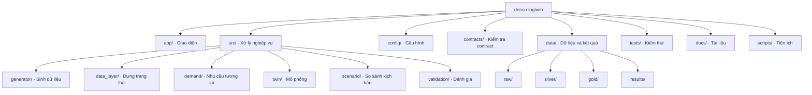
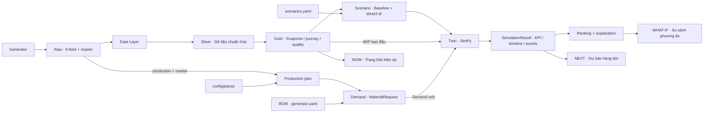
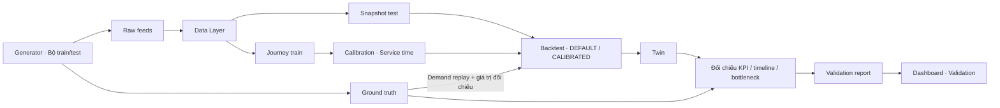

# Cấu trúc dự án DENSO LogTwin

Tài liệu mô tả mã nguồn và luồng xử lý hiện tại. Các khối Mermaid hiển thị trực tiếp trên GitHub; có thể sao chép vào trình biên tập hỗ trợ Mermaid để chỉnh sửa và xuất hình.

## Cây thư mục

Chỉ liệt kê thành phần chính, bỏ qua môi trường Python, cache, file tạm và dữ liệu sinh ra chi tiết.

```text
denso-logtwin/
├── app/
│   └── streamlit_app.py          # Dashboard NOW, NEXT, WHAT-IF, Validation
├── config/
│   ├── generator.yaml           # Nhà máy giả và BOM
│   ├── data_layer.yaml          # Mapping, freshness và snapshot
│   ├── scenarios.yaml           # Kịch bản, horizon và ranking
│   └── plans/                   # Production plan
├── contracts/
│   ├── mock_v0_1.json           # Fixture contract
│   └── validate_contracts.py    # Kiểm tra contract
├── src/
│   ├── generator/               # Sinh dữ liệu nhà máy giả
│   │   ├── world.py             # Môi trường, tài nguyên và RNG
│   │   ├── flow.py              # Luồng vật tư
│   │   ├── demand.py            # Sinh request vận hành
│   │   ├── feeds.py             # Xuất các feed
│   │   ├── breakdown.py         # Sự cố tài nguyên
│   │   └── batch.py             # Sinh dữ liệu nhiều ngày/seed
│   ├── data_layer/              # Raw → silver → gold
│   │   ├── pipeline.py          # Điều phối xử lý
│   │   ├── ingest.py            # Đọc feed
│   │   ├── validate.py          # Kiểm tra dữ liệu đầu vào
│   │   ├── mapper.py            # Nối ID và hành trình
│   │   ├── state_builder.py     # Dựng snapshot và WIP
│   │   ├── freshness.py         # Độ tươi dữ liệu
│   │   └── contract_check.py    # Kiểm tra đầu ra gold
│   ├── demand/                  # Kế hoạch → demand tương lai
│   │   ├── planner.py           # Đọc và điều chỉnh production plan
│   │   ├── conversion.py        # Quy đổi theo BOM thành MaterialRequest
│   │   └── forecast.py          # Hàm hỗ trợ forecast/risk
│   ├── twin/                    # Mô hình Digital Twin
│   │   ├── entities.py          # Các cấu trúc dữ liệu contract
│   │   ├── gold.py              # Đọc snapshot và chạy baseline
│   │   ├── simulation.py        # Điều phối mô phỏng SimPy
│   │   ├── resources.py         # Tài nguyên phục vụ
│   │   ├── process.py           # Xử lý request qua từng stage
│   │   └── metrics.py           # KPI, timeline và event log
│   ├── scenario/                # So sánh phương án vận hành
│   │   ├── scenarios.py         # Tạo baseline và WHAT-IF
│   │   ├── runner.py            # Chạy các kịch bản trên cùng đầu vào
│   │   └── ranking.py           # Xếp hạng và giải thích
│   └── validation/              # Đánh giá mô hình
│       ├── backtest.py          # Replay và đối chiếu ground truth
│       ├── metrics.py           # Tính sai số
│       └── phase8.py            # Pipeline train/test và calibration
├── data/                        # Dữ liệu sinh ra, có thể tái tạo
│   ├── raw/                     # Feed CSV, master và ground truth
│   ├── silver/                  # Dữ liệu chuẩn hóa
│   ├── gold/                    # Snapshot, journey, quality và demand
│   └── results/                 # Kết quả mô phỏng và validation
├── tests/                       # Unit/integration tests và fixtures
├── scripts/                     # Tiện ích kiểm tra dữ liệu
├── docs/                        # Đặc tả và hướng dẫn kỹ thuật
├── contracts_v0.1_spec.md        # Đặc tả contract
├── contracts_v0.1_example.json   # Ví dụ contract
├── requirements.txt            # Thư viện Python
├── README.md                    # Giới thiệu và hướng dẫn chạy
└── LICENSE
```

## Sơ đồ phân nhóm mã nguồn

Dùng khi vẽ cấu trúc repository. Các cạnh biểu thị quan hệ chứa.



## Sơ đồ luồng dữ liệu vận hành

Mũi tên biểu thị dữ liệu được chuyển giữa các bước. Dashboard điều phối việc sinh demand và chạy scenario cho NEXT/WHAT-IF.



## Sơ đồ đánh giá mô hình

Validation dùng ground truth để replay demand và đối chiếu kết quả. Data Layer không đọc `_truth/`. Pipeline calibration sử dụng dữ liệu train riêng, sau đó đánh giá trên dữ liệu test.



## Điểm bắt đầu khi đọc hoặc sửa mã

| Công việc | Điểm bắt đầu |
|---|---|
| Giao diện và tích hợp NOW/NEXT/WHAT-IF | `app/streamlit_app.py` |
| Sinh dữ liệu | `src/generator/__main__.py` |
| Dựng snapshot | `src/data_layer/pipeline.py` |
| Quy đổi kế hoạch sản xuất | `src/demand/planner.py`, `src/demand/conversion.py` |
| Chạy và tính KPI mô phỏng | `src/twin/simulation.py`, `src/twin/metrics.py` |
| Tạo, chạy, xếp hạng scenario | `src/scenario/` |
| Hiệu chỉnh và đánh giá | `src/validation/phase8.py` |
| Kiểm tra định dạng giữa các module | `contracts/validate_contracts.py`, `contracts_v0.1_spec.md` |

Generator, Data Layer, Demand và Twin có entry point `__main__.py`, chạy bằng `python -m src.<module>`. Hướng dẫn cài đặt và lệnh demo nằm trong [README](../README.md).
